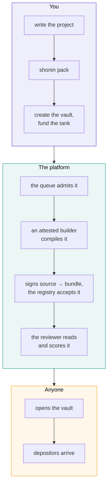

# Publishing a strategy

You write an ordinary Rust project. We compile it, a model reads it, a vault opens, and if people deposit you earn a share of what it makes.

This page is the shape of that, end to end. The mechanism is in the [technical deep-dive](how-it-works/publishing.md).

## What you actually write

One long-lived async function. The host starts it once and never schedules it again; everything the strategy does, it does inside that call.

```rust
impl Strategy for FundingBasis {
    async fn run(config: Vec<u8>) -> Result<(), String> {
        let mut mind = Mind::new(&Config::from_bytes(&config)?);

        // Whatever a previous instance left behind is still on the venue.
        step(&mut mind).await?;

        let mut waking = select(
            venues::account_events(VENUE).into_stream().map(|_| Woke::Venue),
            vault::events().into_stream().map(Woke::Vault),
        );

        while let Some(woke) = waking.next().await {
            match woke {
                Woke::Venue => step(&mut mind).await?,
                Woke::Vault(VaultEvent::ClaimPending(_)) => step(&mut mind).await?,
                Woke::Vault(VaultEvent::Halting(_)) => return flatten(&mind).await,
            }
        }
        Ok(())
    }
}
```

No keys, no signing, no network of your own. You submit decisions and the host tells you what happened to them. Whatever your code decides, it can only ever trade your vault's own accounts, which is what lets a stranger deposit into it.

## Your limits are your code

There is no platform risk policy. We do not impose a leverage cap, a drawdown stop or a position limit.

That is not laziness. A limit we imposed would be a promise about your code that we could not keep, and it would let a depositor believe a number that nothing enforces. So a limit is something you write:

```toml
[config]
max_gross_leverage = "2"
max_order_fraction = "0.10"
idle_buffer        = "0.05"
drawdown_stop      = "0.10"
```

...and something your code enforces, and something the reviewer reads and a depositor can read too. A strategy that claims a cap in its manifest and does not enforce it in its sizing is a finding, and the score says so.

## What it costs to publish

Creating the vault and funding its tank happen in one transaction, and the build service will not admit a job until that vault exists. Nothing is compiled for free.

For a strategy declaring modest allowances — two million fuel a second, 256 MiB, a little bandwidth — the numbers come out like this:

| | |
| --- | ---: |
| The vault's minimum, set by the factory | $40.00 |
| The review, a flat fee | $1.00 |
| A week at those allowances | $50.87 |
| **Least you can fund the tank with** | **$51.87** |

The build itself is metered compute, charged once it has run, so what it comes to is known only afterwards. On the development chain a build of the reference strategy takes about twenty seconds, which at the published prices is under a cent.

Those figures are read from the chain and shown on the publish page before you commit to anything. A heavier strategy costs more a day, and the page prices each shape as you pick it.

**A failed build is charged, because it ran.** The vault closes and you reclaim the rest of the tank. A fixed resubmission is a new vault.

## The tank, and why it exists

Running a strategy costs money: compute, and gas where a chain charges it. That is your cost, not your depositors'.

Each vault has a tank you fund and your own fees refill. It is excluded from what shares are worth, so a depositor's value never pays for your electricity. The executor states each day's usage, signed by the vault's own key, and the contract believes it only up to the allowances you declared at the published prices — so a wrong statement cannot charge you more than you agreed to.

**Auto-fill** redeems a share of each author fee back into the tank, all of it by default, until the tank holds about thirty days of charges. For a modest strategy that target is around $218. Above it, your fee shares are simply yours.

A tank that empties accrues a debt, repaid from future fees before anything reaches you.

## What you earn

Ten per cent of gains above the vault's high-water mark, crystallised daily as new shares.

Concretely: a vault holding a million dollars that returns 20% over a year pays its author about **$19,400** for that year. The first $218 or so refills the tank; the rest is shares you can hold or redeem like any depositor's.

You earn nothing on a recovery back to a previous high, because the high-water mark is the vault's and it does not reset. A strategy that loses 20% and then makes it back has, as far as the fee is concerned, done nothing.

## Publishing, step by step



Opening is a public function. Once the registry holds your bundle, anyone can open the vault — it is not a favour we grant.

## Sealing your source

Source is public by default, and most authors leave it that way, because a published strategy is one anybody can rebuild and check.

If you would rather not show it, upload it sealed. It is encrypted to the platform's key; the attested builder and the attested reviewer still read it, and nobody else does. Sealing changes who can read your code, never whether it was compiled or reviewed.

What a depositor then relies on is the attested build plus the attested review, and the strategy's page says exactly that rather than implying more.

## Versions

A strategy version never changes. Publishing v2 creates a new bundle, a new vault and a declared lineage.

Depositors in v1 are not moved, not asked and not affected — their vault runs exactly the code they chose. Its page shows that a newer version exists and links to it, and moving is a withdrawal there and a deposit here, done when they want to.

The new vault's high-water mark starts fresh, which means you earn on its gains from the beginning.

## Before you publish

The reviewer's prompt and output schema are in the repository. Run the same review over your own code first, against any model you like. It is not signed and it is not binding, but it is the same questions.

Then check the obvious things a review will otherwise find for you: that your sizing is bounded by something in the code, that a rejected order does not leave you thinking you hold a position you do not, and that a restart with an empty cache does the right thing.
