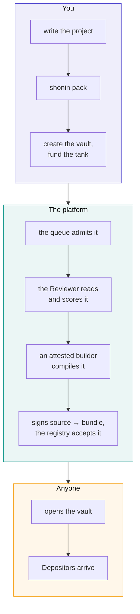

# Authors

You write an ordinary Rust project. We compile it, a model reads it, a vault opens, and if people deposit you earn a share of what it makes.

This page is the shape of that, end to end. The mechanism is in the [technical deep-dive](how-it-works/publishing.md).

## What you actually write

One long-lived async function. The host starts it once and never schedules it again; everything your agent does, it does inside that call. It waits on streams of what the venue and the vault tell it, and decides.

You submit decisions and the host tells you what happened to each one. You never hold a key and never sign anything, and whatever your code decides, it can only ever trade your vault's own accounts.

It reaches the world through seven interfaces, frozen as `shonin:strategy@0.1.0`: your own fills and account state, the vault's events, shared market data, websockets the executor terminates, models you ship in the bundle, a cache, and secrets sealed to your bundle. No filesystem, no environment, no socket of your own.

[Agents](how-it-works/agents.md) has the full interface and a complete example.

## Your limits are your code

There is no platform risk policy. We do not impose a leverage cap, a drawdown stop or a position limit. A limit is something you declare in your manifest's config, enforce in your own code, and the Reviewer reads, and a Depositor can read too. An agent that claims a cap and does not enforce it in its sizing is a finding, and the score says so.

[Limits are code](how-it-works/agents.md#limits-are-code) shows what that looks like.

## What it costs to publish

Creating the vault and funding its tank happen in one transaction, and the build service will not admit a job until that vault exists. Nothing is compiled for free.

For an agent declaring modest allowances (two million fuel a second, 256 MiB, a little bandwidth), the numbers come out like this:

| | |
| --- | ---: |
| The review, a flat fee | $1.00 |
| A week at those allowances | $50.87 |
| **Suggested: the review and a week** | **$51.87** |
| The least you can fund the tank with, the factory's minimum | $40.00 |

The build itself is metered compute, charged once it has run, so what it comes to is known only afterwards. On the development chain a build of the reference agent takes about twenty seconds, which at the published prices is under a cent.

Those figures are read from the chain and shown on the publish page before you commit to anything. A heavier agent costs more a day, and the page prices each shape as you pick it.

**A failed build is charged, because it ran.** The vault closes and you reclaim the rest of the tank. A fixed resubmission is a new vault.

The review runs before the build. Code it finds malicious is refused and never built, and the review fee is the only charge.

## The tank, and why it exists

Running an agent costs money: compute, and gas where a chain charges it. That is your cost, not your Depositors'.

Each vault has a tank: a plain dollar balance for running it, which you fund. It is excluded from what shares are worth, so a Depositor's value never pays for your electricity. The executor keeps a running total of your agent's usage, signed by the vault's own key, stops the agent if the tank can't cover it, and we collect from the tank now and then at our own gas cost. The contract believes the total only up to the allowances you declared at the published prices, so a wrong total cannot charge you more than you agreed to.

Your earnings are shares in the vault, yours to hold or redeem like any Depositor's, and you can turn some into tank money with one click. Or switch on **auto-fill** and pick a number, "keep my tank at $X": every day, if the tank is below $X, just enough of your earnings tops it back up. You can take money out of the tank whenever you like; it settles what your agent owes first.

A tank that empties stops your agent until it's topped up. The minimum covers the review and the build, but it's wise to fund a week of running on top, or your agent may stop before it has earned anything.

## What you earn

Ten per cent of the vault's new profit: gains above the best value per share it has reached at a weekly fee payment, its **high-water mark**. It is worked out every day, shown on your page as it builds up, and paid weekly as new shares. If the vault gives a gain back before the week is out, the fee on it goes too.

Concretely: a vault holding a million dollars that returns 20% over a year pays its Author about **$19,400** for that year. It's paid to you as shares; auto-fill keeps what you've chosen in the tank, and the rest you hold or redeem like any Depositor.

You earn nothing on a recovery back to a previous high, because the high-water mark is the vault's and it does not reset. An agent that loses 20% and then makes it back has, as far as the fee is concerned, done nothing.

## Publishing, step by step

Opening is a public function. Once the registry holds your bundle, anyone can open the vault. It is not a favour we grant.

## Sealing your source

Source is public by default. A published agent is one anybody can rebuild and check.

If you would rather not show it, upload it sealed. It is encrypted to the platform's key; the attested builder and the attested Reviewer still read it, and nobody else does. Sealing changes who can read your code, never whether it was compiled or reviewed.

What a Depositor then relies on is the attested build plus the attested review, and the agent's page says exactly that rather than implying more.

## Versions

A version never changes. Publishing v2 creates a new bundle, a new vault and a declared lineage.

Depositors in v1 are not moved, not asked and not affected: their vault runs exactly the code they chose. Its page shows that a newer version exists and links to it, and moving is a withdrawal there and a deposit here, done when they want to.

The new vault's high-water mark starts fresh, which means you earn on its gains from the beginning.

## Before you publish

The Reviewer's prompt and output schema are in the repository. Run the same review over your own code first, against any model you like. It is not signed and it is not binding, but it is the same questions.

Then check the obvious things a review will otherwise find for you: that your sizing is bounded by something in the code, that a rejected order does not leave you thinking you hold a position you do not, and that a restart with an empty cache does the right thing.
