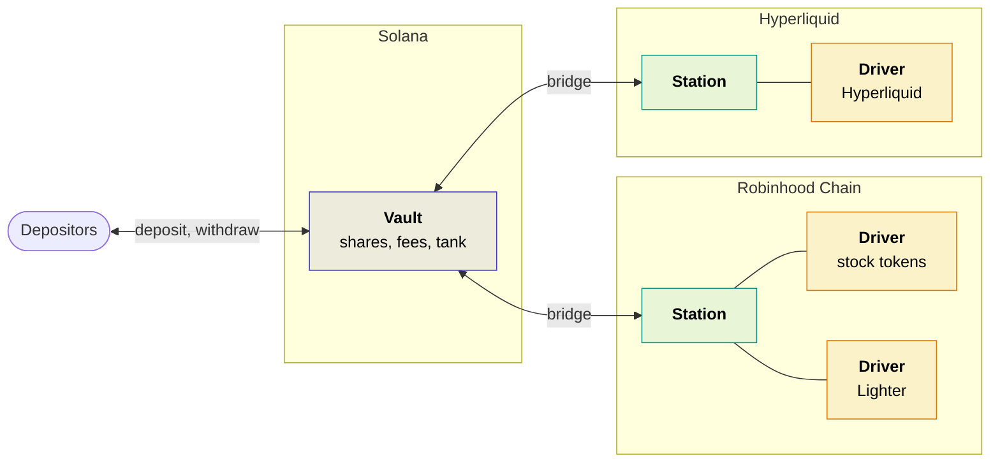
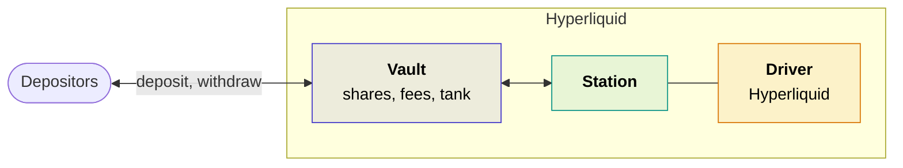

# Smart contracts

On Shonin, smart contracts hold the money and make the rules for moving it, including who may trade it. A trading key can't place a single order until the contracts have checked its attestation: that it was made by an approved image, running this vault's exact agent. And because the key is [trade-only](trade-only-keys.md), being approved lets it trade and nothing more.

<svg viewBox="0 0 1000 380" role="img" aria-labelledby="contract-title contract-desc" xmlns="http://www.w3.org/2000/svg">
<title id="contract-title">A smart contract moving money</title>
<desc id="contract-desc">A smart contract, a friendly page with a face, stands on a chain of blocks with both arms up. In one hand it holds a little key it has checked, with a green check; in the other, a coin. The coin is on a dotted path that runs from the vault on its left to the market on its right, and back.</desc>
<ellipse cx="500" cy="188" rx="400" ry="182" style="fill:var(--h-blob)"/>
<g transform="translate(500 206) scale(1.35) translate(-511 -184)">
<path d="M372 250 l8 -8 h34 l-8 8 Z" style="fill:var(--h-block-top);stroke:var(--h-indigo);stroke-width:1.5;stroke-linejoin:round"/>
<path d="M406 250 l8 -8 v28 l-8 8 Z" style="fill:var(--h-block-side);stroke:var(--h-indigo);stroke-width:1.5;stroke-linejoin:round"/>
<rect x="372" y="250" width="34" height="28" rx="2" style="fill:var(--h-block);stroke:var(--h-indigo);stroke-width:1.5"/>
<path d="M381 260 h16 M381 267 h10" style="stroke:var(--h-indigo);stroke-width:2;stroke-linecap:round;opacity:.6"/>
<ellipse cx="416" cy="264" rx="7" ry="4.5" style="fill:none;stroke:var(--h-ink);stroke-width:2.5"/>
<path d="M420 250 l8 -8 h34 l-8 8 Z" style="fill:var(--h-block-top);stroke:var(--h-indigo);stroke-width:1.5;stroke-linejoin:round"/>
<path d="M454 250 l8 -8 v28 l-8 8 Z" style="fill:var(--h-block-side);stroke:var(--h-indigo);stroke-width:1.5;stroke-linejoin:round"/>
<rect x="420" y="250" width="34" height="28" rx="2" style="fill:var(--h-block);stroke:var(--h-indigo);stroke-width:1.5"/>
<path d="M429 260 h16 M429 267 h10" style="stroke:var(--h-indigo);stroke-width:2;stroke-linecap:round;opacity:.6"/>
<ellipse cx="464" cy="264" rx="7" ry="4.5" style="fill:none;stroke:var(--h-ink);stroke-width:2.5"/>
<path d="M468 250 l8 -8 h34 l-8 8 Z" style="fill:var(--h-block-top);stroke:var(--h-indigo);stroke-width:1.5;stroke-linejoin:round"/>
<path d="M502 250 l8 -8 v28 l-8 8 Z" style="fill:var(--h-block-side);stroke:var(--h-indigo);stroke-width:1.5;stroke-linejoin:round"/>
<rect x="468" y="250" width="34" height="28" rx="2" style="fill:var(--h-block);stroke:var(--h-indigo);stroke-width:1.5"/>
<path d="M477 260 h16 M477 267 h10" style="stroke:var(--h-indigo);stroke-width:2;stroke-linecap:round;opacity:.6"/>
<ellipse cx="512" cy="264" rx="7" ry="4.5" style="fill:none;stroke:var(--h-ink);stroke-width:2.5"/>
<path d="M516 250 l8 -8 h34 l-8 8 Z" style="fill:var(--h-block-top);stroke:var(--h-indigo);stroke-width:1.5;stroke-linejoin:round"/>
<path d="M550 250 l8 -8 v28 l-8 8 Z" style="fill:var(--h-block-side);stroke:var(--h-indigo);stroke-width:1.5;stroke-linejoin:round"/>
<rect x="516" y="250" width="34" height="28" rx="2" style="fill:var(--h-block);stroke:var(--h-indigo);stroke-width:1.5"/>
<path d="M525 260 h16 M525 267 h10" style="stroke:var(--h-indigo);stroke-width:2;stroke-linecap:round;opacity:.6"/>
<ellipse cx="560" cy="264" rx="7" ry="4.5" style="fill:none;stroke:var(--h-ink);stroke-width:2.5"/>
<path d="M564 250 l8 -8 h34 l-8 8 Z" style="fill:var(--h-block-top);stroke:var(--h-indigo);stroke-width:1.5;stroke-linejoin:round"/>
<path d="M598 250 l8 -8 v28 l-8 8 Z" style="fill:var(--h-block-side);stroke:var(--h-indigo);stroke-width:1.5;stroke-linejoin:round"/>
<rect x="564" y="250" width="34" height="28" rx="2" style="fill:var(--h-block);stroke:var(--h-indigo);stroke-width:1.5"/>
<path d="M573 260 h16 M573 267 h10" style="stroke:var(--h-indigo);stroke-width:2;stroke-linecap:round;opacity:.6"/>
<ellipse cx="608" cy="264" rx="7" ry="4.5" style="fill:none;stroke:var(--h-ink);stroke-width:2.5"/>
<path d="M612 250 l8 -8 h34 l-8 8 Z" style="fill:var(--h-block-top);stroke:var(--h-indigo);stroke-width:1.5;stroke-linejoin:round"/>
<path d="M646 250 l8 -8 v28 l-8 8 Z" style="fill:var(--h-block-side);stroke:var(--h-indigo);stroke-width:1.5;stroke-linejoin:round"/>
<rect x="612" y="250" width="34" height="28" rx="2" style="fill:var(--h-block);stroke:var(--h-indigo);stroke-width:1.5"/>
<path d="M621 260 h16 M621 267 h10" style="stroke:var(--h-indigo);stroke-width:2;stroke-linecap:round;opacity:.6"/>
<!-- the money, out to the market and back to the vault -->
<path d="M398 180 C380 0 620 0 626 188" style="fill:none;stroke:var(--h-amber-dark);stroke-width:3.5;stroke-linecap:round;stroke-dasharray:2 8"/>
<path d="M616 178 l10 12 l4 -15" style="fill:none;stroke:var(--h-amber-dark);stroke-width:3.5;stroke-linecap:round;stroke-linejoin:round"/>
<path d="M388 170 l10 12 l4 -15" style="fill:none;stroke:var(--h-amber-dark);stroke-width:3.5;stroke-linecap:round;stroke-linejoin:round"/>
<!-- the vault -->
<g transform="translate(398 219) scale(.33) translate(-695 -227)">
<rect x="600" y="132" width="190" height="190" rx="18" style="fill:var(--h-indigo-soft);stroke:var(--h-indigo);stroke-width:3"/>
<rect x="616" y="148" width="158" height="158" rx="12" style="fill:var(--h-paper);stroke:var(--h-indigo);stroke-width:2"/>
<rect x="606" y="174" width="8" height="24" rx="3" style="fill:var(--h-indigo)"/>
<rect x="606" y="256" width="8" height="24" rx="3" style="fill:var(--h-indigo)"/>
<circle cx="695" cy="227" r="38" style="fill:var(--h-indigo-soft);stroke:var(--h-indigo);stroke-width:3"/>
<path d="M695 201 v-10 M695 253 v10 M669 227 h-10 M721 227 h10" style="stroke:var(--h-indigo);stroke-width:4;stroke-linecap:round"/>
<circle cx="695" cy="227" r="11" style="fill:var(--h-indigo)"/>
</g>
<!-- the market -->
<g transform="translate(624 214) scale(.55) translate(-200 -176)">
<rect x="148" y="140" width="104" height="72" rx="8" style="fill:var(--h-ink)"/>
<rect x="155" y="147" width="90" height="58" rx="4" style="fill:var(--h-screen)"/>
<path d="M176 156 v40 M200 162 v38 M224 152 v36" style="stroke:var(--h-muted);stroke-width:1.5"/>
<rect x="171" y="166" width="10" height="20" rx="2" style="fill:#2dd4bf"/>
<rect x="195" y="172" width="10" height="20" rx="2" style="fill:#f87171"/>
<rect x="219" y="160" width="10" height="20" rx="2" style="fill:#2dd4bf"/>
</g>
<rect x="620" y="234" width="8" height="10" style="fill:var(--h-ink)"/>
<rect x="608" y="243" width="32" height="5" rx="2" style="fill:var(--h-ink)"/>
<!-- the contract, both arms up: a checked key in one hand, the money in the other -->
<g transform="translate(500 250) scale(.72) translate(-500 -228)">
<path d="M486 200 v28 M514 200 v28" style="stroke:var(--h-ink);stroke-width:4;stroke-linecap:round"/>
<path d="M455 88 a8 8 0 0 1 8 -8 h60 l22 22 v90 a8 8 0 0 1 -8 8 h-74 a8 8 0 0 1 -8 -8 Z" style="fill:var(--h-paper);stroke:var(--h-indigo);stroke-width:3;stroke-linejoin:round"/>
<path d="M523 80 v14 a8 8 0 0 0 8 8 h14" style="fill:var(--h-indigo-soft);stroke:var(--h-indigo);stroke-width:3;stroke-linejoin:round"/>
<path d="M470 100 h36 M470 112 h54 M470 124 h44" style="stroke:var(--h-indigo);stroke-width:3;stroke-linecap:round;opacity:.5"/>
<circle cx="485" cy="150" r="5" style="fill:var(--h-ink)"/>
<circle cx="515" cy="150" r="5" style="fill:var(--h-ink)"/>
<circle cx="483" cy="148" r="1.7" style="fill:var(--h-paper)"/>
<circle cx="513" cy="148" r="1.7" style="fill:var(--h-paper)"/>
<circle cx="476" cy="165" r="5" style="fill:#f87171;opacity:.45"/>
<circle cx="524" cy="165" r="5" style="fill:#f87171;opacity:.45"/>
<path d="M489 166 Q500 175 511 166" style="fill:none;stroke:var(--h-ink);stroke-width:3;stroke-linecap:round"/>
<path d="M545 158 C575 150 571 9 567 -21" style="fill:none;stroke:var(--h-ink);stroke-width:4;stroke-linecap:round"/>
<path d="M455 158 C432 152 428 114 426 84" style="fill:none;stroke:var(--h-ink);stroke-width:4;stroke-linecap:round"/>
</g>
<g transform="translate(446 118) scale(.26) translate(-500 -184)">
<rect x="491" y="160" width="18" height="132" rx="6" style="fill:var(--h-amber);stroke:var(--h-coin-ink);stroke-width:3"/>
<rect x="507" y="238" width="18" height="13" rx="2" style="fill:var(--h-amber);stroke:var(--h-coin-ink);stroke-width:3"/>
<rect x="507" y="264" width="24" height="16" rx="2" style="fill:var(--h-amber);stroke:var(--h-coin-ink);stroke-width:3"/>
<rect x="494" y="236" width="12" height="46" style="fill:var(--h-amber)"/>
<circle cx="500" cy="120" r="44" style="fill:var(--h-amber);stroke:var(--h-coin-ink);stroke-width:3"/>
<rect x="494" y="158" width="12" height="10" style="fill:var(--h-amber)"/>
<circle cx="482" cy="112" r="6" style="fill:var(--h-coin-ink)"/>
<circle cx="510" cy="112" r="6" style="fill:var(--h-coin-ink)"/>
<circle cx="480" cy="110" r="2" style="fill:#ffffff"/>
<circle cx="508" cy="110" r="2" style="fill:#ffffff"/>
<circle cx="474" cy="128" r="5" style="fill:#f87171;opacity:.45"/>
<circle cx="526" cy="128" r="5" style="fill:#f87171;opacity:.45"/>
<path d="M484 129 Q496 140 508 129" style="fill:none;stroke:var(--h-coin-ink);stroke-width:3;stroke-linecap:round"/>
</g>
<circle cx="463" cy="92" r="8" style="fill:var(--h-teal);stroke:var(--h-paper);stroke-width:2"/>
<path d="M459 92 l3 3 l5 -6" style="fill:none;stroke:var(--h-badge-ink);stroke-width:2;stroke-linecap:round;stroke-linejoin:round"/>
<circle cx="551.5" cy="57.7" r="14" style="fill:var(--h-amber);stroke:var(--h-coin-ink);stroke-width:2.5"/>
<text x="551.5" y="63.2" class="h-coin" style="font-size:15px">$</text>
</g>
<text x="347" y="372" class="h-caption">the vault</text>
<text x="485" y="372" class="h-caption">the contract</text>
<text x="652" y="372" class="h-caption">the market</text>
</svg>

## They're the same for every agent

**No agent brings a contract of its own.** Every vault, and everything else on this page, runs the same open-source contract code, written by us and shared by every agent on Shonin. An agent is only the program on the attested machine: it decides what to trade, and the contracts decide what that's allowed to do. So once you know how these contracts behave, you know how they behave for every agent, whoever wrote it.

## They hold the money

Every vault is a smart contract. When you put money in, it goes into the vault, and it only ever moves between the vault and its own stations. Deposits, fees and withdrawals are all paid by the contract, and every trade is on the public record. The agent's running costs come from a separate balance, [the tank](../tank.md), which the Author pays for.

## Where they live

A contract lives on one chain and can only move money on that chain, so an agent that trades on several chains needs contracts on each. Let's look at a complicated multi-chain setup first, and then simplify to single-chain.

### Across three chains

Take an agent that buys tokenised shares on Robinhood Chain and hedges them with perpetuals on Lighter (also on Robinhood Chain), then also places orders on Hyperliquid (e.g. wherever the hedge is cheaper). Its Author chose Solana for its vault, because that's where their Depositors already keep their dollars.

- **The vault**, on Solana. It's the only contract Depositors ever deal with: it takes their deposits, pays their withdrawals, issues their shares, pays the fees and holds the [tank](../tank.md). Every agent has exactly one.
- **A station** on each chain the agent trades on. It holds the money the agent trades with on that chain, takes no deposits and issues no shares, and reports what it holds to the vault, so the vault's share price counts every chain.
- **A driver** for each venue, plugged into the station on its chain: two on Robinhood Chain, one on Hyperliquid. A driver is what knows how to work with one venue. It lets the vault's trade-only keys trade there, works out what the station holds there, and closes positions when someone withdraws. The vault and the stations know nothing about any venue, so a new venue is just a new driver.
- **Bridges** carry money between the vault and its stations: only the ones the agent names, and the station checks on the chain that the money will arrive at the vault's own address on the other side.

Money comes in and goes out only at the vault. A deposit lands on Solana, and the agent moves what it needs out to its stations. A withdrawal is paid on Solana, and if the vault's cash there isn't enough, money is brought home from the stations first.

### On one chain

Now let's look at the setup for a single chain, like the [example rebalancer](../writing/rebalancer.md), which lives on Hyperliquid and trades only there. It's the same shape, only smaller: the vault, one station beside it and one driver. There's no bridge: the vault moves money to its station directly and reads what it's worth straight from the chain, and Depositors' money never leaves Hyperliquid.

### The contracts, in short

| Contract | Where | What it does |
| --- | --- | --- |
| Vault | One per agent, on the chain its Author chose | Deposits, withdrawals, shares, fees and the tank |
| Station | One per chain the agent trades on, the vault's own included | Owns the agent's accounts on that chain, and reports what they're worth to the vault |
| Driver | One for each venue, plugged into the station on its chain | Knows how to work with that venue: lets the vault's trade-only keys trade there, works out what the station holds there, and closes positions when someone withdraws |
| Registries | Every chain we support | The approved machine images and the keys they've blessed, the published agents and their builds, and their reviews; shared by every vault |
| Publishing | Every chain a vault can live on | Takes the $1 to publish, and gives each agent its id |
| Factories | Every chain we support | Create a vault, and its station on the same chain, when the Author activates it; stations on other chains are created by its executor |

## Real markets, messy data

None of this keeps the agent in a box.

The thinking happens off-chain, on the attested machine, where the agent can follow the messy, real-time world: prices from anywhere, the news, anything online. The agent gets the whole internet to decide with, while the money never leaves the contracts.

[Next: the tank →](../tank.md){ .md-button .md-button--primary }
