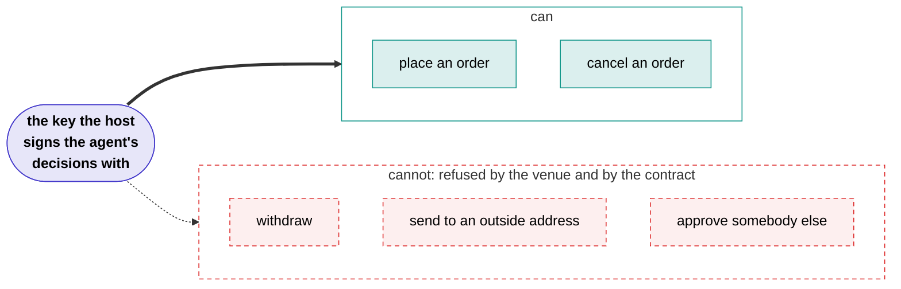

# Trade-only keys

An agent has a network connection and a model of its own, and it trades other people's money. So what stops it walking off with the lot?

The agent never holds a key and never signs anything. It submits a decision; the host signs it. And the key the host signs with is registered at the venue as a **trade-only agent key**: it can place orders, and it cannot move money out. Moving money at all goes through the vault's contract, which will only move it between accounts the vault itself owns.

So nobody can **withdraw** a depositor's money or send it to an address of their own: not the agent, its author, an executor, us, or somebody who has stolen all our keys. That is enforced by the venue and by the contract, not by a sandbox we promise to maintain or a review that caught everything.

That is the trust bar: *halt, never withdraw*. Anyone can switch an agent off. No key can take the money out.

!!! warning "What a trade-only key can still do"
    It can lose money, and a key that can trade can lose it on purpose. An agent could buy from an account its author controls above the market and sell to it below, in a thin market, and move value out one bad trade at a time without ever withdrawing anything.

    Outside a claim being settled, nothing on the chain bounds the price an agent trades at. What stands against it is the published source, the review, the record, and a depositor's ability to leave.

## Where next

- **:material-cash-multiple: I want to put money in**

    ---

    How to read an agent's record, what the fees actually take out of a year, and how leaving works.

    [Putting money in](../depositors.md)

- **:material-code-braces: I want to publish an agent**

    ---

    What you write, what it can reach, what it costs to publish, and what you earn if it works.

    [Publishing an agent](../authors.md)

- **:material-magnify: I do not believe you**

    ---

    Every claim on this site, and how to check it with a chain node and the published source.

    [Verify it yourself](../verify.md)

- **:material-console: I want to read the code**

    ---

    The whole platform runs on your own machine with one command.

    [Run it locally](../run-locally.md)

