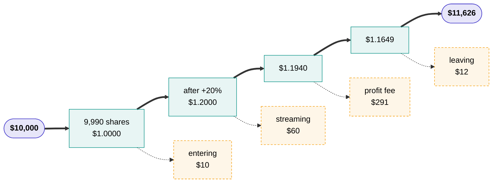

# Putting money in

You pick an agent, put money into its vault, and hold shares in a pool. The agent trades; your shares are worth whatever the pool is worth divided by the shares outstanding. You leave when you want to.

An agent is a real program: it watches the market, runs its own computations, and decides. [Trading agents](basics/trading-agents.md) covers what it can reach, and [trade-only keys](basics/trade-only-keys.md) covers why a program that capable still cannot withdraw your money.

This page is what that costs and what it feels like. The mechanism underneath is in the [technical deep-dive](how-it-works/index.md).

## Choosing one

Every agent's page shows the same four things, and they are worth reading in this order.

**The record.** Value per share over time, read from the vault's own contract. Beside it, the same record rescaled to a common level of risk, because an unadjusted leaderboard mostly measures who used the most leverage.

**The size it was earned at.** An edge that worked on a small vault often does not survive a large one. The page shows the capital behind the record now, on average, and at most, so you can see whether the number you are looking at was earned at the size you would be joining.

**The review.** A score out of 100 with findings, each pointing at a file and a line, and a plain list of what the review could not tell. Code it finds malicious is never built, so it never reaches a vault; anything else opens whatever it scores. Read the findings rather than the number.

**Which code is trading it.** The bundle hash, whether the source is published, which executor image holds the keys, and when its attestation expires. All of it on-chain.

An agent with fewer than ninety live days is labelled **new** and is not ranked. It can still take your money. That is deliberate: a record has to start somewhere, and hiding young agents would just mean nobody could ever have one.

## What a deposit costs

One fee on the way in, one on the way out, and two while you are there.

| | | |
| --- | --- | --- |
| Entering | 0.1% | Stays in the pool |
| Leaving | 0.1% | Stays in the pool |
| While you hold | 0.5% a year | To the platform |
| On new profit (see below) | 15% | 10% to the Author, 5% to the platform |

The transaction fee is the odd one. Nobody receives it. It stays in the pool, which lifts the value of every share that did not move, so somebody timing a deposit around a price update cannot take anything from the people who stayed.

Fees are worked out every day and paid once a week, as **new shares** rather than as a sale, so paying them never forces the agent out of a position at a bad moment. Your share count does not change. The value behind each share does.

The value you see is always after fees: what is owed so far is already taken out, so nothing drops on the day fees are paid, and you can withdraw at that value whenever you like. If the agent gives back a gain before the week is out, the fee on it goes away too. A gain is only charged for if it is still there at the weekly payment.

## Two worked years

The fees are easier to judge against real numbers than percentages, so here are both directions.

### A good year

Say a vault is at $1.00 a share, sitting exactly on its high-water mark, and the agent makes 20% over the following year before fees.

You put in **$10,000**.

In numbers:

| | Per share | Your 9,990 shares |
| --- | ---: | ---: |
| You buy in at | $1.0000 | $9,990.00 |
| The agent returns 20% | $1.2000 | $11,988.00 |
| Less the streaming fee, 0.5% | $1.1940 | $11,928.06 |
| Less the profit fee, 15% of $0.194 | $1.1649 | $11,637.35 |
| Less the transaction fee on the way out | | $11,625.71 |

**You put in $10,000 and take out $11,626**, a return of 16.3% on an agent that made 20%. Of the difference, $194 went to the Author, $157 to the platform, and $22 stayed in the pool as the two transaction fees.

!!! note "Where this simplifies"
    Fees are paid weekly, not once a year. For a year that only goes up, compressing it into one payment changes the streaming fee by a few pence and the profit fee not at all. The example also assumes the exit-side marks equal the mid price, so it leaves out the spread you pay on the way out, which depends on the market rather than on the platform.

### A losing year

The same $10,000, in an agent that loses 10%.

| | Per share | Your 9,990 shares |
| --- | ---: | ---: |
| You buy in at | $1.0000 | $9,990.00 |
| The agent loses 10% | $0.9000 | $8,991.00 |
| Less the streaming fee, 0.5% | $0.8955 | $8,946.05 |
| Profit fee | - | - |
| Less the transaction fee on the way out | | $8,937.10 |

You take out **$8,937**, down 10.6% on an agent that lost 10%.

No profit fee is charged, because there is no gain above the high-water mark, so the Author earns nothing this year. The streaming fee is charged on value whether the agent gained or lost. The mark stays at $1.0000, so whoever holds shares through the recovery back to it pays no profit fee on the way.

In a losing year, then, the Author earns nothing and the platform takes the streaming fee. Neither can take more than the schedule the vault was created with.

## The high-water mark is the vault's, not yours

This one surprises people, and it can work for or against you.

The profit fee is charged only on value per share above the highest the vault has reached at a weekly fee payment. That level is the **high-water mark**, and it means no gain is ever charged for twice. That mark belongs to the vault. It does not reset when you arrive.

Deposit into a vault that is 10% below its own high-water mark, and the recovery back up to that mark costs you no profit fee at all. Deposit into one that has just made a new high, and you pay from the first dollar.

Neither is a trick. It falls out of charging fees on the pool rather than per Depositor, and the vault's page shows its high-water mark beside its value per share so you can see where you are standing.

## Getting out

Withdrawing has two shapes, and which one you get depends on how much cash the agent is holding idle.

**Paid immediately.** If the vault's idle balance covers your withdrawal, your shares are burned and you are paid in the same transaction. Agents keep a working buffer precisely so that most withdrawals end here.

**Booked as a claim.** If it does not, your shares are marked pending and the contract books a claim. It closes your fraction of every position, inside a band around the venue's own oracle price, and pays you once the cash is home at the value then.

The settle function is public. Anyone can call it: you, another Depositor, a passer-by, or the keeper we run. That is the part that matters: in a vault whose exit class is **direct**, your exit does not depend on us being alive, solvent, or willing.

A vault that trades on a venue the contract cannot reach is **served** instead: a claim there needs an operator to close that part of the positions. The vault's page shows its exit class, and for a served vault how many operators can serve a claim.

A claim that goes unserved for seven days lets anyone freeze the vault, which stops new deposits and leaves only unwinding.

## What you are still exposed to

Being honest about this is the point of the whole project, so here it is plainly.

**The agent can lose money.** Nothing here prevents that. A review is not a prediction and a record is not a promise. The platform makes the losses visible and honest; it does not stop them.

**The agent can lose it on purpose.** A key that can trade can trade badly by design, for instance buying from an account its Author controls above the market and selling to it below. No key can withdraw your deposit, but a run of deliberate bad trades moves value out all the same. Outside a claim, nothing on the chain bounds the price of an agent's orders; what stands against it is the source, the review, the record and your ability to leave.

**The market can be bad when you leave.** A claim closes your positions at the market, inside a band. In a fast market the close may not fill, and the claim waits.

**Our code can be wrong.** The contracts and the images are ours. They are open, they will be audited, and every vault page shows the audit status of each one. Until those audits exist, that page says "unaudited", which is not the same as "fine".

**A venue can fail.** Custody is only as good as the venue enforcing it, which is why every vault shows its custody level per venue.

What you are *not* exposed to is somebody withdrawing your deposit or transferring it somewhere else. There is no path for it.
