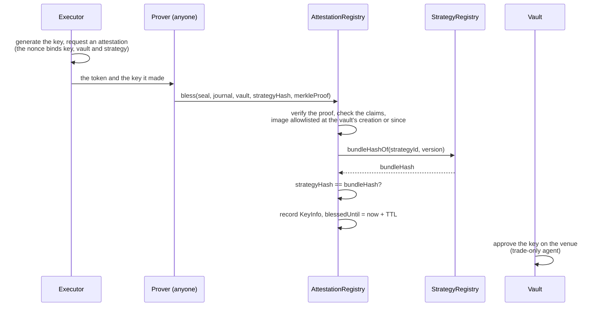

# Attested execution

Somebody has to hold the keys that trade. The question is what those keys can do, and how you know which code is holding them.

## The keys can only trade

Start here, because everything else is a refinement of it.

A vault's trading key is registered with the venue as a **trade-only agent**. It can place orders and cancel them. It cannot withdraw, cannot transfer to an outside address, and cannot approve anyone else. Moving capital at all goes through the vault contract, which will only move it between accounts the vault itself owns.

So the worst an entirely compromised executor can do is **trade badly**. There is no route out for it to take, which is why the trust bar is *halt, never steal* rather than a promise about our staff.

Attestation is what tells you which code holds a key. It is not what stops the key stealing.

## Blessing a key



The executor generates its key inside the enclave and asks for an attestation token whose nonce commits to the pairs of vault and bundle it holds keys for. Verifying that token on-chain directly would be expensive, so the check runs inside a zero-knowledge guest that commits a compact journal — the image, the project, the key, the nonce — and a proof of that execution is what the registry verifies.

**Anyone can be the prover.** The proof is what the registry checks, not who sent it.

What gets recorded:

```solidity
struct KeyInfo {
    bytes32   imageDigest;   // the image the key was generated in
    ImageKind kind;          // Executor, Unwinder, Builder or Reviewer
    bytes32   strategyHash;  // the bundle it may run
    address   vault;         // the one vault it may act for
    bytes32   trustRoot;     // what the proof was checked against
    uint64    blessedUntil;  // expiry; attest again to renew
}
```

- **One key, one vault, one strategy version.** A key blessed for vault A cannot trade or move capital for vault B. A vault's strategy version never changes, so neither does what its keys may run.
- **Time-limited.** A blessing lasts a fixed period — 72 hours by default — and the executor renews by attesting again.
- **Kinds are separate.** An image is allowlisted as one kind, and a key blessed from it can only do that kind's job. A key from a builder image cannot post a review.
- **Approval follows blessing, permissionlessly.** Anyone may send the vault's `approveKey`, and it succeeds only if the registry says that key belongs to this vault and this strategy on an allowed image. Anyone may send `revokeKey`, and it succeeds only for a key whose blessing has lapsed or whose image was revoked.

## The allowlist

The registry keeps the list of images that may hold a key at all — executors, unwinders, the build service and the reviewer — and the operator projects that may run them.

- **Adding is slow and public.** A new image digest can be proposed at any time, and becomes blessable only after a timelock, two days by default. During that window anyone can rebuild the image from its published source and check the digest, and object.
- **Removing is instant.** A revoked image stops being blessable immediately.
- **The admin key can only do those two things.** It cannot bless keys, move funds, or change a vault's strategy.

## The one asymmetry

The **strategy** never changes: it is what the depositor chose.

The **executor** is our code, and it has to be patchable — a runtime fix has to be able to reach a running vault. What bounds that power is the timelock, a reproducible image, and instant revocation. A running vault adopts a new image by failover: a standby on the new image is blessed and takes over, with the vault's own on-chain approval as the handoff.

Nobody needs a special exit window for it, because you can withdraw at any time. The timelock exists so that outsiders can rebuild the image and object before anyone runs it.

## What the host enforces

A strategy runs inside a WebAssembly runtime with real limits:

| Limit | How |
| --- | --- |
| Fairness | The runtime takes control back every few milliseconds whatever the strategy is doing, so no strategy can starve another |
| Memory | Capped by a resource limiter at the strategy's declared allowance |
| Compute | The declared fuel rate is what the vault's tank is billed for, and how often the strategy yields |
| The outside world | No filesystem, no environment, no sockets of its own; network access is terminated by the host under the strategy's declared quotas |
| Faults | A strategy that traps is torn down and started again, and the restart is counted in the vault's health report |

## Revocation is a halt

If an image is revoked for cause:

1. its keys stop being honoured by the registry and by every vault;
2. each affected vault's venue approvals are revoked;
3. a standby on another allowed image takes over — and if there is none, the vault stops trading, which shows as an error on its page.

Admins can kill a vault, which flattens positions and pays every depositor out. Depositors can exit on their own without waiting for anyone.

A vault **never** resumes on a runtime its depositors did not accept. Revocation can halt a strategy. It cannot hand the keys to someone else.

## Health reports

The executor publishes a signed health report per vault: restarts, faults, refused submissions, venue errors, and what the tank has left. It is signed by the key the registry blessed for that vault, over a canonical encoding of the report, and the API refuses one from any other key — so the page repeats the instance, not whoever spoke last.

It is operational evidence, never the record of what the strategy did. That is on the chain, where nobody can backfill it. Nothing a depositor needs in order to leave depends on a health report.
