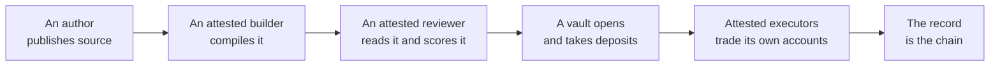

# How it works

Five things happen, in order, and each one leaves evidence on a chain.

## 1. An author publishes source

An author writes an ordinary Rust project: their code, their dependencies, a pinned toolchain, and a manifest that declares what the strategy is, which venues it trades, the config it takes and the compute it needs. They pack it and submit it. They do not submit a binary — the platform compiles it, which is the only way a reader can tie running code to source they can read.

Creating the vault and funding its tank happen in the same transaction. Nothing is compiled for free.

→ [Strategies](strategies.md), [Publishing](publishing.md)

## 2. An attested builder compiles it

The build service takes jobs first come, first served, with one in flight per author, and a public log either way. It compiles the project with a pinned recipe, then signs the mapping from the source it read to the bundle it produced. The strategy registry accepts a bundle only with that signature.

The builder runs on an image that sits on the same public, timelocked allowlist as every other image, so anyone can rebuild it and check what it does.

→ [Publishing](publishing.md)

## 3. An attested reviewer reads it

A pinned model, with a pinned prompt and a pinned output schema, reads the source and answers one question: **is this code reasonable?** It returns a score out of 100 and findings, each in a fixed category, each with a severity, each pointing at a file and a line.

It is a score, not a gate. It never rates expected profit, and it has never stopped a vault opening.

→ [The review](review.md)

## 4. A vault opens

One vault per strategy version, with ERC-4626 accounting. A deposit is valued at mark in the same transaction and mints shares at that value. A withdrawal is valued at exit-side marks — a long at the bid, a short at the ask — so the person leaving pays the spread rather than the pool.

If the vault's idle balance covers a withdrawal, the shares are burned and you are paid in the same transaction. If not, a **claim** is booked: your shares go pending, the contract closes your fraction of every position inside a narrow band around the venue's oracle price, and once the cash is home you are paid at the marks then. There is one path out and it always pays cash.

A strategy version never changes. A new version is a new bundle, a new vault, and a declared lineage — never an edit of something you already deposited into.

→ [Vaults](vaults.md)

## 5. Attested executors trade

The vault's trading keys are generated inside an attested enclave and never leave it. A registry checks the attestation and records what each key may do: which image it was made in, which bundle it may run, which one vault it may act for, and when the blessing expires.

What stops a key stealing is not the attestation. It is that the venue and the vault contract will only let that key move funds **between the vault's own accounts**. There is no route out, so there is nothing for a compromised executor to take.

→ [Attested execution](execution.md)

## 6. The record is the chain

Returns are read from each vault's own value per share, which the contract computes from on-chain state. No reports, no epochs, nothing anyone posts. Every trade is a public event on the venue. The indexer that turns this into a leaderboard is open source, so you can run your own and compare.

→ [The record](record.md)

## What the platform never does

- It never takes custody of your money. A vault's contract holds it and pays you.
- It never decides a strategy's risk. Limits live in the strategy's own code, where the reviewer reads them and you can too.
- It never re-runs a strategy to check it. Strategies are not deterministic; attestation is the witness, not replay.
- It never edits a running vault's code.
