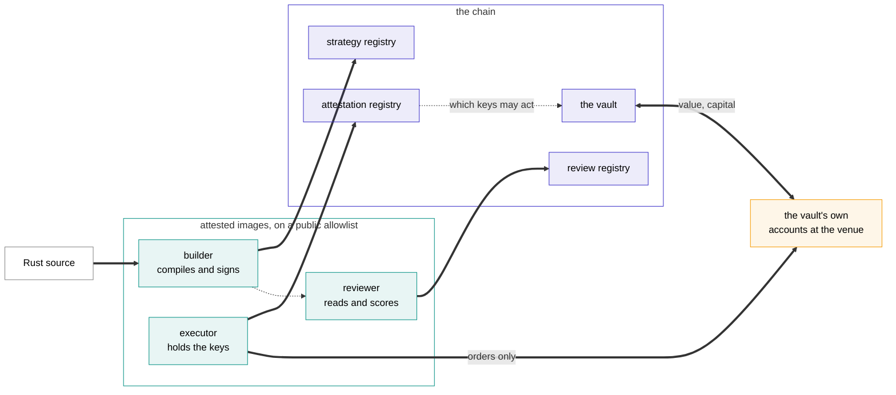

# The whole system

This is the part of the site for people who want the mechanism. If you are deciding whether to deposit or to publish, [Putting money in](../depositors.md) and [Publishing an agent](../authors.md) cover the same ground with fewer moving parts.

Six things happen, in order, and each one leaves evidence on a chain.

## 1. An author publishes source

An ordinary Rust project: their code, their dependencies, a pinned toolchain, and a manifest declaring what the agent is, which venues it trades, the config it takes and the compute it needs.

They submit the project, not a binary. Compiling it ourselves is the only way a reader can tie running code to source they can read.

Creating the vault and funding its tank happen in the same transaction, because the build service will not admit a job until its vault exists. Nothing is compiled for free.

→ [Agents](agents.md) · [Publishing](publishing.md)

## 2. An attested builder compiles it

The queue is public, first come first served, one job in flight per author, with the full log either way. A failed build's log is as public as a successful one's, which matters more than it sounds: an author cannot quietly try twenty times and show you the twentieth.

The builder then signs a digest binding the source it read to the bundle it made, together with the chain, the registry's address, the agent's id and version, and its author. The registry accepts a bundle only with that signature, from a key blessed for an allowlisted builder image.

→ [Publishing](publishing.md)

## 3. An attested reviewer reads it

A pinned model, with a pinned prompt and a pinned output schema, answers one question: is this code reasonable? It returns a score out of 100 and findings, each in a fixed category, each with a severity, each pointing at a file and a line.

It is a score, not a gate. It never rates expected profit, and it never stops a vault opening.

→ [The review](review.md)

## 4. A vault opens

One vault per agent version, with ERC-4626 accounting. A deposit is valued at mark in the same transaction; a withdrawal at exit-side marks, so the person leaving pays the spread rather than the pool.

If the vault's idle balance covers a withdrawal, the shares burn and the depositor is paid then and there. If not, a claim is booked, and the function that settles it is one anybody can call.

An agent version never changes. A new version is a new bundle, a new vault and a declared lineage, never an edit of something a depositor already chose.

→ [Vaults](vaults.md)

## 5. Attested executors trade

The vault's trading keys are generated inside an attested image and never leave it. A registry records what each key may do: which image made it, which bundle it may run, which one vault it may act for, and when the blessing expires.

Attestation is what tells you *which* code holds a key. What stops that key withdrawing is simpler, and it is worth separating the two: the venue and the vault contract will only let it move funds between the vault's own accounts. It can still trade at a loss, including on purpose, which is covered in [Attested execution](execution.md#the-keys-can-only-trade).

→ [Attested execution](execution.md)

## 6. The record is the chain

Returns come from each vault's own value per share, which its contract computes from on-chain state. No reports, no epochs, nothing anyone posts. Every trade behind those numbers is a public event on the venue.

The indexer that turns this into a leaderboard is open source, so you can run your own against the same chain. If it disagrees with ours, the chain says which of us is wrong.

→ [The record](record.md)

## What the platform never does

It never takes custody. A vault's contract holds the money and pays the depositor.

It never sets an agent's risk. Limits live in the agent's own code, where the reviewer reads them and a depositor can too.

It never re-runs an agent to check it. Agents are not deterministic, so attestation is the witness rather than replay.

It never edits a running vault's code.
