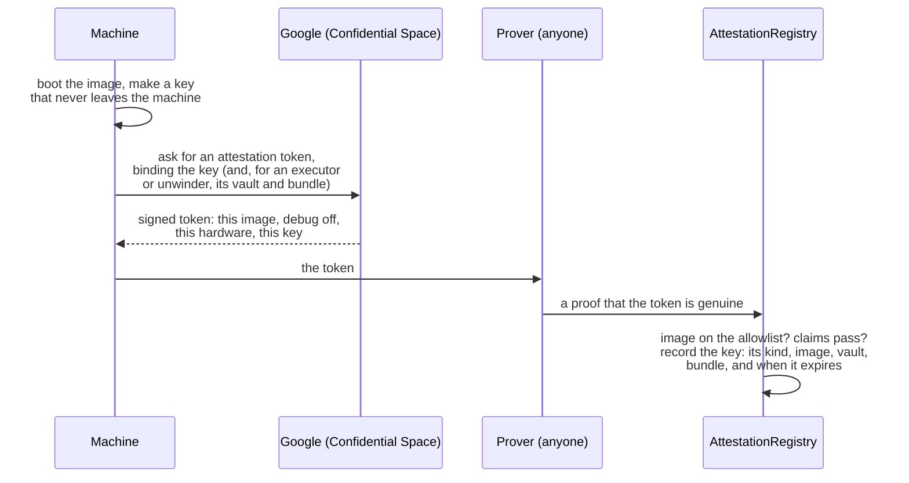

# The machines, one by one

Four kinds of attested machine run Shonin: the **Reviewer**, the **builder**, the **executor** and the **unwinder**. Each runs its own image, proves which image it is, and can only do its own job. This page follows each one through: what it receives, what it holds, what it signs, and what the chain checks.

## What attestation proves, and what it doesn't

Attestation proves **which code** a machine is running. It does not watch what that code does from moment to moment. So the promise behind every machine is the same, in two parts:

1. **Only an approved image can hold a key or read a secret.** The chain checks this every time.
2. **What an approved image does is what its published code does.** Every image is open source, rebuildable to the same digest, and only counts two days after it's added to the allowlist, so anyone can read it before it runs.

So "only our attested machines can read sealed source" means: the source is encrypted so that only machines proving an allowlisted image can decrypt it, and those images' published code says what happens to it. The one place it leaves an attested machine is the AI model the Reviewer consults, a hosted service whose terms rule out training on it or keeping it.

## What every machine does first

Whatever its job, a machine starts the same way:

- **The key is made inside the machine** and never leaves it, so whoever runs the machine, us included, never sees it.
- **Google signs the token**, not us. It names the exact image, and that debugging is off, so nobody can read the machine's memory.
- **Anyone can be the prover.** The registry checks the proof, not who sent it.
- **Every key has a kind.** An image is allowlisted as a Reviewer, builder, executor or unwinder, and a key from it can only do that kind's job. A builder key can't post a review, and a Reviewer key can't trade.
- **Blessings expire** after 72 hours, and a machine renews by attesting again. Revoking an image stops its keys at once.

## The root key: how sealed things stay sealed

Everything sealed (an Author's source, a sealed bundle, an agent's secrets) is encrypted under keys derived from one **root key**. The root key exists only inside attested machines.

- **It passes only by attested key exchange.** A machine holding the root key hands it to another only if that machine proves an allowlisted image, the same check as a blessing. Adding an image takes two days and is public, so who could ever receive the root key is visible in advance.
- **There's no way to export it.** No cloud key service, no administrator setting, no export path in any image.
- **Each image only derives what its job needs:**

| Image | What it can decrypt |
| --- | --- |
| Reviewer | Sealed source, to read it |
| Builder | Sealed source, to compile it |
| Executor | The sealed bundles and secrets of the agents it runs, and nothing else |
| Unwinder | Nothing sealed; it never sees an agent's code |

## The Reviewer

**Receives** an Author's upload, once the publishing deposit is paid. If it's sealed, it decrypts it inside.

**Does:**

1. Hashes the source itself. It never takes a hash from outside.
2. Reads it with the pinned AI model, using the pinned instructions, and answers the fixed questions that set each area's rating.
3. Writes the report.

**Signs** the review with its blessed key. The review registry accepts it only from a key blessed as a Reviewer on an allowed image, and only if its source hash matches the one the builder signs later. A refusal is recorded instead, in the transaction that returns the deposit, and nothing is built.

**Holds** a credential for the hosted AI model, which only the Reviewer image can obtain.

**Can't** build, trade or move money.

## The builder

**Receives** the same upload, once the review has passed it, and decrypts it if it's sealed.

**Does:**

1. Hashes the source itself, which must match the Reviewer's.
2. Compiles it once, offline, with the published recipe.
3. Loads the result to check it works, and assembles the bundle.
4. Reads the manifest to learn which venues, and so which chains, the agent needs.

**Signs** "this source and manifest → this bundle", together with the chain, the registry, the agent's id and its Author, so the signature can't be reused for anything else. The strategy registry accepts a bundle only with a signature from a key blessed as a builder.

**Then creates the vault.** In the same step as registering the bundle, the builder's key creates the vault on the home chain and the vault's own accounts on every other chain it trades, and moves the deposit, less the $1, into the tank. These are transactions, and their gas comes out of the deposit. If the build fails, the builder returns the deposit instead, less the $1 and the gas to send it.

**Can't** trade, review, or touch a vault once it's created.

## The executor

**Receives** its vaults from our scheduler, and for each one the agent's bundle and its sealed secrets, which only it can decrypt.

**Does:**

1. Makes one key for each of the vault's venue accounts, inside the machine.
2. Attests, binding those keys to the vault and to the bundle it will run. The registry blesses them only if that bundle is exactly the one registered for the vault's agent.
3. Once blessed, the vault approves the keys at each venue with the narrowest powers the venue offers: trade, never withdraw.
4. Runs the agent in its sandbox, signing the orders it submits, but only for the vault's own accounts.
5. Keeps the signed running total of usage and gas that the tank pays, and publishes a signed health report.

**Holds** the vault's trading keys, and a standby executor in another zone holds its own, ready to take over.

**Can't** withdraw. The venue and the vault contract refuse it, whatever the executor's code says.

## The unwinder

A separate, smaller image with no agent in it at all. It exists for the venues a vault's contract can't reach by itself, and any allowlisted operator can run it, not only us.

**Receives** a booked withdrawal, a kill or a retirement to serve.

**Does** close the vault's positions there with reduce-only orders, inside the exit band, and send the cash only to the vault's own address. On exchanges that can only be read through their own API, it reads the account and signs its value, so the vault can price it.

**Holds** keys blessed for the vaults it serves, with the narrowest powers each venue offers. Its costs are repaid from the withdrawal it serves, never from the tank.

**Can't** run an agent, open a position, or send money anywhere but home.

## At a glance

| | Reviewer | Builder | Executor | Unwinder |
| --- | --- | --- | --- | --- |
| **Receives** | The upload | The upload, after the review | Its vaults' bundles and secrets | Withdrawals, kills and retirements to serve |
| **Decrypts** | Sealed source | Sealed source | Its agents' sealed bundles and secrets | Nothing sealed |
| **Signs** | The review | Source → bundle, and the vault's creation | Orders, the usage total, health reports | Reduce-only closes, account values |
| **The chain checks** | Reviewer key, allowed image, matching hashes | Builder key, allowed image | Blessed for this vault and this bundle | Blessed for this vault, unwinder kind |
| **Can't** | Build, trade, move money | Trade, review | Withdraw | Run an agent, send money anywhere but home |
