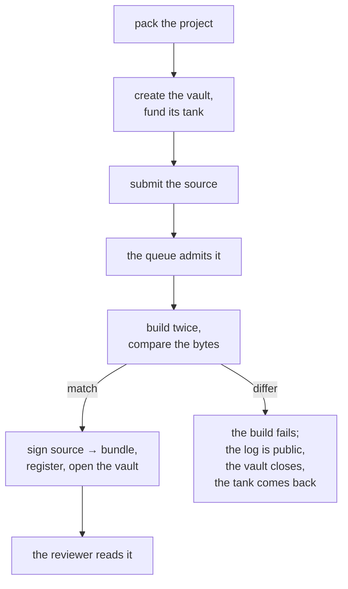

# Publishing

From a Cargo project to an open vault, with a public log at every step.



## What you submit

A submission is the whole **workspace** your strategy belongs to, packed the same way every time so that its hash means something:

```bash
shonin pack packages/bots/your-strategy > strategy.tar
```

The archive is canonical — sorted entries, fixed metadata — so the same tree always produces the same bytes and the same hash. That hash is what the vault is created with, so the chain and the build service are talking about one thing.

You can upload it **sealed**. A sealed project is encrypted to the platform's key; the attested builder and the attested reviewer still read it, and nobody else does. Sealing changes who can read the source, never whether it was compiled or reviewed.

## The vault comes first

Creating the vault and funding its tank happen in one transaction, and the build service will not admit a job until that vault exists. Nothing is ever compiled for free.

The tank has to cover:

| Charge | Why |
| --- | --- |
| The vault's minimum | What the factory will not create a vault below |
| The review | A flat fee, one model call over the source |
| A week at the declared allowances | So the strategy can actually run |

The build itself is metered compute and is charged once it has run, so what it comes to is known only afterwards. The publish page shows every one of these figures read from the chain, not from a number written into the app.

**There is no publishing fee.** Creating the vault funds its tank, and the build and the review are its first charges.

## The queue

Public, first come first served, one job in flight per author, and the full log either way — a failed build's log is as public as a successful one's.

Each job shows its position while it waits, what it is doing while it builds, and how long it took when it is done.

## The build

The recipe is fixed and published, so anyone can repeat it:

- a pinned toolchain and a pinned dependency snapshot, `--locked`, offline;
- the target is `wasm32-wasip2`, and `rustc` emits the component itself;
- paths remapped and timestamps fixed, so nothing about the machine leaks into the bytes;
- **build twice and compare**. A project whose output is not stable is refused, because a build that cannot be repeated cannot be checked by anyone else.

Then the bundle is assembled — the component, plus any models the project ships — and hashed.

## The signature

The build service signs a digest that binds:

```text
(sourceHash, manifestHash) → bundleHash
```

together with the chain, the registry's own address, the strategy's id and version, and its author — so a signature for one registration can never be replayed as another. The strategy registry accepts a bundle **only** with that signature, from a key blessed for an allowlisted builder image.

A vault's executors are then blessed for that exact `bundleHash`, so the chain from published source to running code is unbroken.

## Admission and charges

- A build is admitted once its vault exists and its tank covers the minimum.
- **A failed build is charged, because it ran.** The vault closes and the author reclaims the rest of the tank. A fixed resubmission is a new vault.
- A build service that crashes requeues the job at no charge.
- A project whose manifest names a different strategy or version than the vault it is building for is refused before it compiles, rather than after it has cost anything.

## Opening

Once the registry holds the bundle, **anyone** can open the vault — it is a public function, not a favour. From that moment it takes deposits, labelled **new** until it has ninety live days.

A vault opens before any audit, with the audit status of every contract and image it runs on shown on its page. Waiting for an audit to open would mean no record, and the record is what a depositor is actually choosing between.

## What you get

A strategy page with:

- the record, read from the vault's own contract;
- the review, with its score and findings;
- the source, the `Cargo.toml` and the `Cargo.lock`, the build log and the toolchain;
- the bundle, component, source and manifest hashes;
- which keys are blessed for the vault and what they may run;
- the vault: its value, its fees, its tank, its claims.
