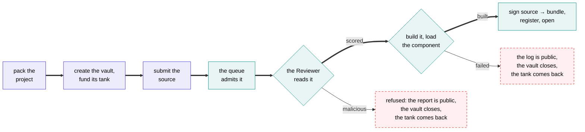

# Publishing

From a Cargo project to an open vault, with a public log at every step.



## What you submit

A submission is the whole **workspace** your agent belongs to, packed the same way every time so that its hash means something:

```bash
shonin pack path/to/your-agent > agent.tar
```

The archive is canonical, with sorted entries and fixed metadata, so the same tree always produces the same bytes and the same hash. That hash is what the vault is created with, so the chain and the build service are talking about one thing.

You can upload it **sealed**. A sealed project is encrypted to the platform's key; the attested builder and the attested Reviewer still read it, and nobody else does. Sealing changes who can read the source, never whether it was compiled or reviewed.

## The vault comes first

Creating the vault and funding its tank happen in one transaction, and the build service will not admit a job until that vault exists. Nothing is ever compiled for free.

The tank has to hold at least the factory's minimum, the least any vault can be created with, which covers the review's flat fee and the build. Past that it's up to the Author. A week at the declared allowances is a sensible start, since an agent whose tank runs dry stops.

The build itself is metered compute and is charged once it has run, so what it comes to is known only afterwards. The publish page shows every one of these figures read from the chain, not from a number written into the app.

**There is no publishing fee.** Creating the vault funds its tank, and the review and the build are its first charges.

## The queue

Public, first come first served, one job in flight per Author, and the full log either way. A failed build's log is as public as a successful one's.

Each job shows its position while it waits, what it is doing while it builds, and how long it took when it is done.

## The review comes first

Before anything is compiled, the attested Reviewer reads the source. Compiling Rust runs the Author's own code, in build scripts and procedural macros, so reading it first means none of that runs on the builder until it has been read.

If the Reviewer finds the code **malicious**, the project is refused and never built. The review fee is charged, because the review ran; the vault closes and the Author reclaims the rest of the tank; and the refusal is recorded on-chain against the source hash, with the full report public. Anything short of malicious is a score and goes on to the build. [The review](review.md) has what it looks for.

## The build

The recipe is fixed and published, so anyone can repeat it:

- a pinned toolchain and the build service's own copy of the SDK;
- `--locked`, so the dependency graph is the one the Author committed;
- the target is `wasm32-wasip2`, and `rustc` emits the component itself.

The project is built **once**. What a Depositor relies on is that an attested machine ran this recipe over that source and signed what came out of it, and an attested machine cannot misreport what it did.

The component is then loaded in the executor's own runtime, to check it satisfies the world before anything is registered, and the bundle, the component plus any models the project ships, is assembled and hashed.

!!! note "Why not build it twice and compare?"
    Because it would prove less than it looks. Two builds on the same machine, seconds apart, differ in almost nothing, so they test the easy cases and not the ones that actually break someone else's rebuild.

    Reproducing a bundle elsewhere is a property of a hermetic recipe, and making the recipe hermetic is the work: a pinned image, fixed paths, a fixed timestamp, no network.

    A project that reaches for a clock, the network or a random number while it compiles is a finding the Reviewer reports as hidden behaviour, and it scores the agent down.

## The signature

The build service signs a digest that binds:

```text
(sourceHash, manifestHash) → bundleHash
```

together with the chain, the registry's own address, the agent's id and version, and its Author, so a signature for one registration can never be replayed as another. The strategy registry accepts a bundle **only** with that signature, from a key blessed for an allowlisted builder image.

A vault's executors are then blessed for that exact `bundleHash`, so the chain from published source to running code is unbroken.

## Admission and charges

- A job is admitted once its vault exists and its tank covers the minimum.
- **Every submission has limits, generous but not unlimited:** a maximum size for the source, and a maximum time to build it. They're published with the other parameters. A project over the size limit is refused before the review runs, so it costs nothing; a build that runs past the time limit fails, and is charged like any failed build.
- **A refused project is charged the review fee, because the review ran.** The vault closes and the Author reclaims the rest of the tank.
- **A failed build is charged, because it ran.** The vault closes and the Author reclaims the rest of the tank. A fixed resubmission is a new vault.
- A build service that crashes requeues the job at no charge.
- A project whose manifest names a different agent or version than the vault it is building for is refused before it compiles, rather than after it has cost anything.

## Opening

Once the registry holds the bundle, **anyone** can open the vault. It is a public function, not a favour. From that moment it takes deposits, labelled **new** until it has the record it needs to be ranked.

A vault opens before any audit, with the audit status of every contract and image it runs on shown on its page. Waiting for an audit to open would mean no record, and the record is what a Depositor is actually choosing between.

## What you get

An agent page with:

- the record, read from the vault's own contract;
- the review, with its score and findings;
- the source, the `Cargo.toml` and the `Cargo.lock`, the build log and the toolchain;
- the bundle, component, source and manifest hashes;
- which keys are blessed for the vault and what they may run;
- the vault: its value, its fees, its tank, its claims.
