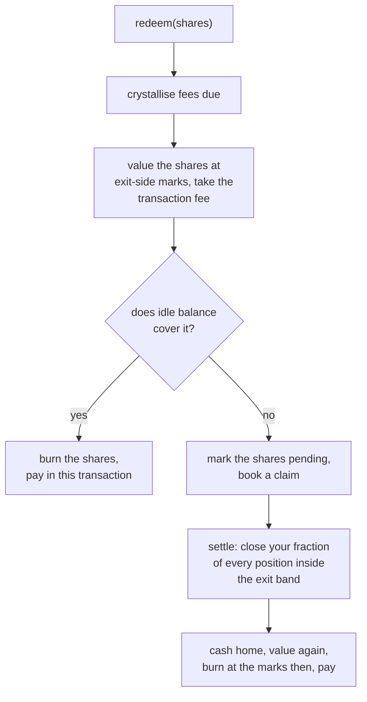

# Vaults

A vault is one contract holding one pool of capital behind one strategy version. It computes its own value, mints and burns its own shares, pays its own withdrawals, and charges its own fees. Nobody reports anything to it.

## Shares

Shares follow **ERC-4626**, the standard interface for tokenised vaults: the vault is an ERC-20 whose shares are a pro-rata claim on a pool of one asset, with a share price of assets divided by shares that wallets and other contracts already understand.

A deposit mints shares at the vault's current value per share. Your profit and loss is your shares times today's value per share, less what you paid.

The standard's one fairness rule — round against whoever is moving — is applied to prices as well as to shares:

| Moving | Valued at |
| --- | --- |
| Depositing | Mark |
| Withdrawing | Exit-side marks: a long at the best bid, a short at the best ask |

So the mover pays the spread, and the pool never does.

!!! note "Not fully ERC-4626 compliant"
    `redeem` may book a claim rather than transfer assets, in the manner of ERC-7540. An integrator should expect that.

## Leaving



**Paid at once.** Strategies keep a working buffer of idle capital, so most withdrawals end here: the shares are burned and you are paid in the same transaction.

**Booked as a claim.** When idle capital cannot cover it, your shares are marked pending and the contract books a claim. A claim has three states: *pending*, *waiting* (a settlement was tried and the market was outside the band), and *paid*.

**Anyone can settle it.** `settle` is a public function. You do not need us, or the author, or the executor, to get your money. If every one of our services stopped this minute, a depositor could still send the settle transaction themselves and be paid.

**The exit band.** A claim's positions are closed with reduce-only immediate-or-cancel orders limited to the venue's oracle price plus or minus the exit band, 1% by default. The pool's cost beyond the spread is bounded by that band times the notional closed. If the market is outside the band the close does not fill, the claim waits, and settlement is retried.

**Who bears what.** The leaver pays the spread through exit-side marks, pays the transaction fee, and bears the close's impact pro rata with everyone else, because their shares are still outstanding when it lands. The depositors who stay keep the transaction fee.

**A frozen vault.** A claim that goes unserved for the freeze period — seven days by default — lets anyone freeze the vault: no new deposits, and only unwinding remains possible.

## Fees

Fees crystallise daily as **new shares**, so paying them never forces a sale.

```text
daily, anyone can call crystallise():

  streaming fee  = value × 0.5% × (days since last) / 365      → the platform
  if value per share (after streaming) > high-water mark:
      gains      = (value per share − high-water mark) × shares
      author fee = gains × 10%                                  → the author
      platform   = gains × 5%                                   → the platform
      high-water mark = the new value per share

on every deposit and withdrawal:
  transaction fee = 0.1% of the amount                          → stays in the pool
```

- **The high-water mark is the vault's own.** It is the highest value per share the vault has ever crystallised at, so profit fees are only taken on new highs. A loss followed by a recovery pays nothing on the recovery.
- **The transaction fee is nobody's.** It stays in the pool and raises value per share for the depositors who stay, so timing a deposit or a withdrawal around a price update cannot take value from them.
- **Moving to a new version** costs the transaction fee out and in, and the new vault's high-water mark starts fresh.

The schedule is fixed when a vault is created and never changes under it. A vault's page shows its own schedule, not today's default.

## The tank

Running a strategy costs money: compute, and gas where a chain charges it. That is the **author's** cost, not the depositors'.

Each vault has a **tank**, which the author funds when they create it and their own fees refill. It is excluded from what shares are worth, so a depositor's value never pays for the strategy's electricity.

- The build and the review are the tank's first charges.
- The executor states each day's usage, signed by the vault's own blessed key, and the contract believes it only up to the allowances the author declared at the platform's published prices. A wrong statement cannot charge more than the author agreed to.
- **Auto-fill** redeems a share of each author fee back into the tank — all of it, by default — until the tank holds its target, around thirty days of charges. It is paid from idle balance and waits for the next day when there is not enough, never booking a claim.
- A tank that runs dry accrues a debt, repaid from future author fees before anything reaches the author.

Every vault page shows the tank's balance, what it is charging and how long that lasts.

## A kill

Shonin's admin key can **kill** any vault, typically after its health report shows it failing. A kill closes every position through the same reduce-only path a claim uses and brings all the cash home. After that the vault holds only idle balance, so every depositor's withdrawal is paid in one transaction.

It moves no funds anywhere but back to depositors. It is a halt, never a theft. Every kill is announced on the vault's page and on a public feed, with its reason.

## What the chain verifies

| Fact | On the chain |
| --- | --- |
| Share supply, deposits, withdrawals, pending shares, claims and their settlement | ✓ |
| Fees, the high-water mark, the tank and what it was charged | ✓ |
| The vault's value, computed by the contract from venue state | ✓ |
| Which keys may act for the vault, and what they may run | ✓ |
| Every order and fill on the venue | ✓ |
