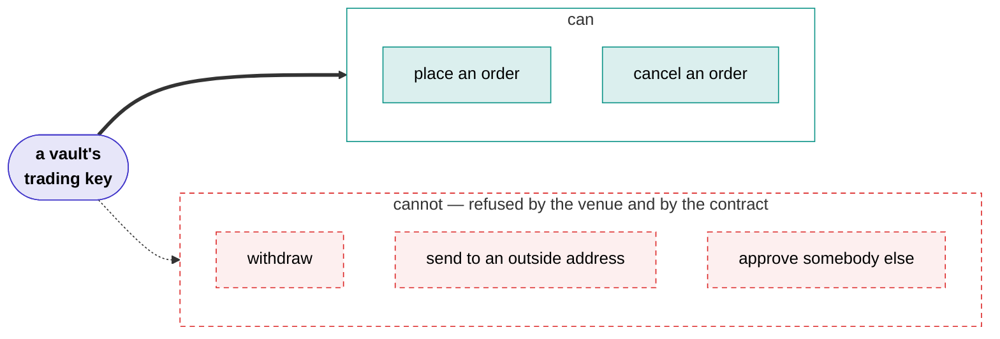

# Shonin

**Smart contracts are public and auditable. Trading bots should be too.**

Somebody is running a trading strategy with your money. You would like to know what it does, whether it can lose more than you agreed to, and whether you can get out. Almost everywhere, the answer to all three is a screenshot and a promise.

Shonin is built so that none of it rests on a promise.

An author publishes a strategy as source code. We compile it, a model reads it and scores it, and attested machines run it with keys that can trade and cannot withdraw. You put money into a vault behind the strategies you like. Every trade, every fee and every unit of value lands on a chain, where it stays.

## The one thing worth understanding

If you read nothing else on this site, read this.

A vault's trading key is registered with the venue as a **trade-only agent**. It can place orders. It cannot move money out. Moving money at all goes through the vault's contract, which will only move it between accounts the vault itself owns.

So the worst thing anyone can do to your deposit — an author, an executor, us, or somebody who has stolen all our keys — is **trade it badly**. There is no route out for them to take.

That is why the trust bar here is *halt, never steal*. Anyone can switch a strategy off. Nobody can take the money.

## What that buys you

You can leave whenever you want, and you do not need us to do it. A withdrawal is paid out of the vault's idle balance in the same transaction. If there is not enough sitting idle, the contract books a claim, closes your share of every position, and pays you when the cash is home. The function that drives that is public: if every service we run stopped tonight, you could send it yourself.

You can check the returns rather than believe them. The vault contract computes its own value from on-chain state, so a record is value per share over time, read from the chain. There is nothing to backfill and nothing to restate.

You can read the code. Most strategies publish their source, and the build is designed so that anyone can compile it and compare hashes. An author can seal their source if they would rather not show it, and then what you are relying on is the attested build and the attested review, which the page says plainly.

## Where to go next

- **:material-cash-multiple: I want to put money in**

    ---

    What a deposit costs, what the fees actually take out of a year, and how leaving works.

    [Putting money in](depositors.md)

- **:material-code-braces: I want to publish a strategy**

    ---

    What you write, what it costs to publish, and what you earn if it works.

    [Publishing a strategy](authors.md)

- **:material-magnify: I do not believe you**

    ---

    Every claim on this site, and how to check it with a chain node and the published source.

    [Verify it yourself](verify.md)

- **:material-console: I want to read the code**

    ---

    The whole platform runs on your own machine with one command.

    [Run it locally](run-locally.md)

## Where the project is today

Everything above runs, end to end, on a local development chain: the contracts, the build service, the reviewer, an executor, the keeper, the indexer and the web app.

Nothing is deployed to a public chain yet. There is no live vault and no money in anything. The [build checklist](checklist.md) is the honest list of what stands between here and there, and it is long.

The source is not public yet either. That is on the checklist and it is near the top of it, because a page that tells you to check things for yourself is worth very little until you can.

These docs describe what is built. Where something is designed but not finished, the page says so rather than using the present tense and hoping.
