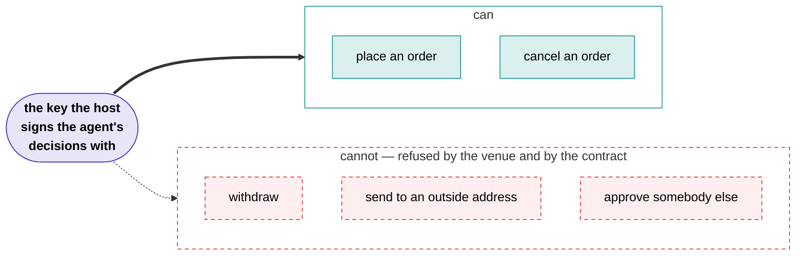

# Shonin

**Smart contracts are public and auditable. Trading bots should be too.**

Somebody is running a trading bot with your money. You would like to know what it does, whether it can lose more than you agreed to, and whether you can get out. Almost everywhere, the answer to all three is a screenshot and a promise.

Shonin is built so that none of it rests on a promise.

An author publishes a trading **agent** as source code. We compile it, a model reads it and scores it, and attested machines run it with keys that can trade and cannot withdraw. You put money into a vault behind the agents you like. Every trade, every fee and every unit of value lands on a chain, where it stays.

## What an agent actually is

"Trading bot" is the phrase everybody knows, and it undersells this badly. Not a configuration. Not a formula sitting in a contract. Not a grid bot with three parameters and a stop.

An agent is a **real program**, written in Rust, compiled to a WebAssembly component, running continuously on a machine we attest. It has its own memory, its own control flow, and a long-lived async function that the host starts once and never schedules again. Everything it does, it does inside that call.

```rust
// It wakes on what the market and the vault tell it, and decides.
while let Some(woke) = waking.next().await {
    match woke {
        Woke::Venue => step(&mut mind).await?,          // a fill, a funding payment, a price
        Woke::Vault(ClaimPending(_)) => step(&mut mind).await?,  // a depositor is leaving
        Woke::Vault(Halting(_)) => return flatten(&mind).await,  // unwind, don't be unwound
    }
}
```

It can reach out. It can compute. It can call a model it shipped.

| It can | Through |
| --- | --- |
| Watch its own fills, funding and account state, as a live stream | `venues` |
| Read market data the executor fetches once and shares | `data` |
| Hold an open websocket to a host, terminated by the executor | `websocket` |
| Run an ONNX model it packed in its own bundle | `inference` |
| Keep a cache across events, and across a restart | `state` |
| Use a secret sealed to its own bundle hash, which we cannot read | `secrets` |
| Submit orders, cancels and capital moves, and be told what happened to each | `venues` |

That is the whole interface, frozen as `shonin:strategy@0.1.0`. An author writes against it with an SDK; the host implements it inside the measured image. No filesystem, no environment, no sockets of its own — everything it reaches, it reaches through one of those seven doors.

!!! abstract "Agent, or strategy?"
    Same thing. **Agent** is the program: the code that runs, reacts and decides. **Strategy** is what it is trying to do, and it is the word the contracts use — `StrategyRegistry`, `strategyId`, one vault per strategy version. These pages say *agent* when the point is the running program and *strategy* when the point is the published, versioned thing a vault sits behind.

So an agent can fetch a funding curve, run a model over it, size a position from the output, place both legs of a hedge, and unwind itself when a depositor leaves — because it is software, with the tools software has.

!!! info "What runs today"
    The venue stream, the vault stream, market data, the state cache, sealed secrets and the full order path all work on the development chain. Outward websockets and model inference are in the frozen interface but not yet implemented by the executor: a call to either returns an error rather than pretending. Both are on the [checklist](checklist.md#execution).

## Why that is safe anyway

You have just been told that a program with a network connection and a model of its own is going to trade your money. The obvious question is what stops it walking off with the lot.

The agent never holds a key and never signs anything. It submits a decision; the host signs it. And the key the host signs with is registered at the venue as a **trade-only agent key**: it can place orders, and it cannot move money out. Moving money at all goes through the vault's contract, which will only move it between accounts the vault itself owns.

So the worst thing anyone can do to your deposit — the agent, its author, an executor, us, or somebody who has stolen all our keys — is **trade it badly**. There is no route out for them to take.

That is what makes it safe to let a program this capable near other people's money. Not a sandbox we promise to maintain, and not a review that caught everything. The money simply has nowhere else to go.

That is the trust bar: *halt, never steal*. Anyone can switch an agent off. Nobody can take the money.



## What that buys you

You can leave whenever you want, and you do not need us to do it. A withdrawal is paid out of the vault's idle balance in the same transaction. If there is not enough sitting idle, the contract books a claim, closes your share of every position, and pays you when the cash is home. The function that drives that is public: if every service we run stopped tonight, you could send it yourself.

You can check the returns rather than believe them. The vault contract computes its own value from on-chain state, so a record is value per share over time, read from the chain. There is nothing to backfill and nothing to restate.

You can read the code. Most agents publish their source, and the build is designed so that anyone can compile it and compare hashes. An author can seal their source if they would rather not show it, and then what you are relying on is the attested build and the attested review, which the page says plainly.

## Where to go next

<div class="grid cards" markdown>

- **:material-cash-multiple: I want to put money in**

    ---

    How to read an agent's record, what the fees actually take out of a year, and how leaving works.

    [Putting money in](depositors.md)

- **:material-code-braces: I want to publish an agent**

    ---

    What you write, what it can reach, what it costs to publish, and what you earn if it works.

    [Publishing an agent](authors.md)

- **:material-magnify: I do not believe you**

    ---

    Every claim on this site, and how to check it with a chain node and the published source.

    [Verify it yourself](verify.md)

- **:material-console: I want to read the code**

    ---

    The whole platform runs on your own machine with one command.

    [Run it locally](run-locally.md)

</div>

## Where the project is today

Everything above runs, end to end, on a local development chain: the contracts, the build service, the reviewer, an executor, the keeper, the indexer and the web app.

Nothing is deployed to a public chain yet. There is no live vault and no money in anything. The [build checklist](checklist.md) is the honest list of what stands between here and there, and it is long.

The source is not public yet either. That is on the checklist and it is near the top of it, because a page that tells you to check things for yourself is worth very little until you can.

These docs describe what is built. Where something is designed but not finished, the page says so rather than using the present tense and hoping.
