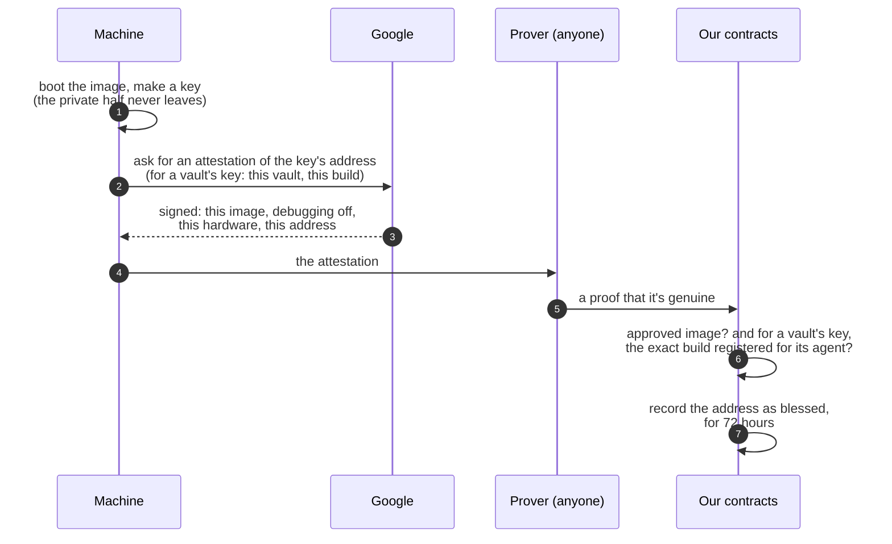
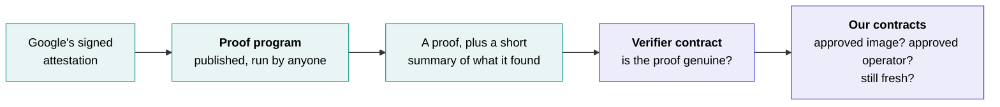
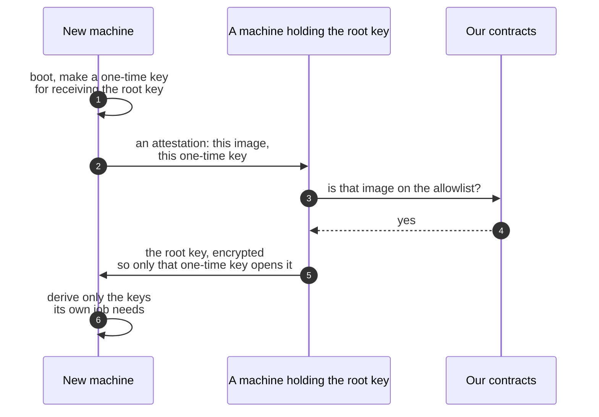

# Attestation and keys

Every machine that runs Shonin, whatever its job, is trusted the same way: it proves which code it's running, and our contracts only let proven, approved code hold a key. This page explains how that works, and how it stays honest as our code changes. [The machines](machines.md) describes what each one does.

## What attestation proves, and what it doesn't

Attestation proves **which code** a machine is running. It doesn't watch what that code does. So the promise behind every machine comes in two parts:

1. **Only an approved image can hold a key or read a secret.** The chain checks this every time.
2. **An approved image does what its published code says.** Every image is open source, rebuilds to the same fingerprint, and only counts after a public wait on the [allowlist](#the-allowlist), so anyone can read it before it runs.

Sealed source can only be decrypted by approved images, and their published code says what they do with it. It only ever leaves the machine for the AI model the Reviewer consults, whose terms rule out training on it or keeping it.

## Blessing a key

Every machine starts the same way: it makes a key, proves which image made it, and has our contracts record the key's public half, its address. That record is the key's **blessing**, and no key can do anything without one.

- **The private key never leaves the machine,** so whoever runs the machine, us included, never sees it. Only the key's address, its public half, is attested and recorded, and that's all anyone needs to check a signature came from it.
- **Google signs the attestation, not us.** It names the exact image, and confirms debugging is off, so nobody can read the machine's memory.
- **Anyone can send the proof,** because our contracts check the proof itself, not who sent it. [Proving an attestation](#proving-an-attestation) explains how.
- **Every key has a kind.** An image is approved as a Reviewer, builder, executor or unwinder, and its keys can only do that job. A builder's key can't post a review, and a Reviewer's key can't trade.
- **A vault's key belongs to one vault and one agent.** An executor's or unwinder's key is blessed for one vault and the exact build its agent runs. It can't act for any other vault, and since a vault's agent never changes, neither does what its keys may run.
- **Blessings expire** after 72 hours, and a machine renews by attesting again. Revoking an image stops our contracts accepting its keys at once. Their approvals at each venue are withdrawn as soon as anyone asks, and at a venue that can't withdraw one straight away, a key lasts at most until its blessing expires.

A blessing alone doesn't reach a venue. The vault's [station](../basics/smart-contracts.md#where-they-live) on that chain approves the key there, through the venue's driver, and the venue only accepts orders from keys the station approved. **Anyone can ask** for a key to be approved, and it only works if the key is blessed for this vault and this build. Likewise anyone can ask for a key to be removed, and that only works once its blessing has lapsed or its image was revoked. So keys come and go by the rules alone, with nobody's permission needed.

## Proving an attestation

Google's attestation is a signed certificate: a signature, backed by a chain of certificates up to Google's own. Checking all of that inside a smart contract would be slow and very expensive, and each chain would need its own version. So it's checked once, off the chain, by a small published program running in [RISC Zero](https://risczero.com)'s zero-knowledge virtual machine, and the chain checks a **zero-knowledge proof** that the program ran and said yes.

**The proof program** checks everything that would be too expensive on-chain:

- the certificate chain, up to Google's root certificate: each certificate valid when the attestation was issued, each signed by the next, the ones above the first allowed to sign certificates;
- Google's signature over the attestation;
- that debugging is off, the hardware is a genuine secure enclave, and its security patches are recent enough;
- that the image was started with exactly its published settings, since an honest image run with dishonest settings isn't honest.

It then commits a short **summary**: which image, which operator's account ran it, the key's address and what it's bound to, when the attestation was issued, and the fingerprint of the root certificate the chain ends in.

**The proof** shows that this exact program ran on this attestation and produced this summary. It's small and cheap to check, and it's impossible in practice to make one for an attestation the program would have refused.

**On the chain,** RISC Zero's audited verifier contract checks the proof, and ours then check the summary: that the chain ends in the Google root certificate they pin, the image is on the [allowlist](#the-allowlist), the operator is approved, and the attestation is still fresh. Our contracts only accept proofs from the one published proof program, identified by its fingerprint, so a proof from any other program counts for nothing. Changing that program, or the Google root certificate it trusts, goes through the same public wait as a new image, so how attestations are checked can never change quietly.

**Anyone can run the program and send the proof,** us included, since the chain checks the proof itself, not who sent it. It's run once per machine each time its blessing is renewed, and one proof covers every vault an executor serves.

## The root key: how sealed things stay sealed

Sealed source, builds and secrets have to stay readable as machines come and go, when a standby takes over or a new image replaces an old one, yet never be readable anywhere else. So they're all encrypted under keys derived from one **root key**, which is handed from machine to machine and never exists outside them.

- **It passes only between attested machines.** A machine holding the root key hands it on only to a machine proving an approved image, the same check as a blessing. Adding an image is slow and public, so who could ever receive it is visible in advance.
- **There's no way to take it out.** No cloud key service, no administrator setting, no export in any image.
- **Each image can only unlock what its job needs:**

| Image | What it can decrypt |
| --- | --- |
| Reviewer | Sealed source, to read it |
| Builder | Sealed source, to compile it |
| Executor | The sealed builds and secrets of the agents it runs, and nothing else |
| Unwinder | Nothing sealed: it never sees an agent's code |

The root key is kept in enough machines, in enough places, that losing every copy would take a disaster. If it ever happened, sealed agents could never run again, since sealing them anew would make them new agents. So Shonin's admin key would wind such a vault down, as it would kill one: its positions closed, its cash brought home, and the vault left for everyone to withdraw from.

## The allowlist

Our contracts keep the list of images that may hold a key at all, and the operators allowed to run them.

- **Adding is slow and public.** A new image can be proposed at any time, but only counts after a wait, two days once outside money is at stake. In that time anyone can rebuild it from its published source, check its fingerprint, and object.
- **The wait can't be cut quietly.** The contracts enforce it: raising the wait takes effect at once, but lowering it takes as long as the current wait. Every vault's page shows the current wait, and any change waiting to take effect is announced on every vault's page, on our website and on our Discord.
- **Removing is instant.** A revoked image can't be blessed again, and its keys stop working.
- **The same rules cover the checker itself.** A new [proof program](#proving-an-attestation), or a new Google root certificate, waits out the same public wait before it counts, and the old one keeps working meanwhile. Retiring one is instant.
- **Shonin's admin key governs the list,** and beyond that it can only [kill a vault](vaults.md#a-kill). It can't bless a key, move money anywhere but back to Depositors, or change a vault's agent.

## Changing our own images

An **agent** never changes: it's what Depositors chose. Our own images do, because a fix has to be able to reach a running vault, and a new driver needs its executor side in the image. What keeps that honest is the public wait, images anyone can rebuild, and instant revocation.

A new image never means downtime:

1. It's proposed in public, and its wait starts.
2. Every vault keeps running on the image it has.
3. When the wait is over, a standby on the new image is blessed and takes over each vault.
4. For a new driver, agents that use it can be published from then on.

Depositors can leave at any time, so nobody needs a special window to get out first. The wait is there so that outsiders can check a new image before it runs.

## Revocation is a halt

If an image is revoked for cause:

1. its keys stop working at our contracts, and anyone can have their approvals at each venue withdrawn;
2. a standby on another approved image takes over;
3. if there's none, the vault stops trading until an approved image can take over, which can take as long as the public wait. Its positions sit unmanaged meanwhile, and its page shows an error.

A vault **never** carries on under code its Depositors didn't accept. Revocation can halt an agent, but it can't hand its keys to anyone else.

Depositors can still leave a halted vault on their own, and the admin key can kill it, which closes its positions and pays everyone out.

[Next: the machines →](machines.md){ .md-button .md-button--primary }
