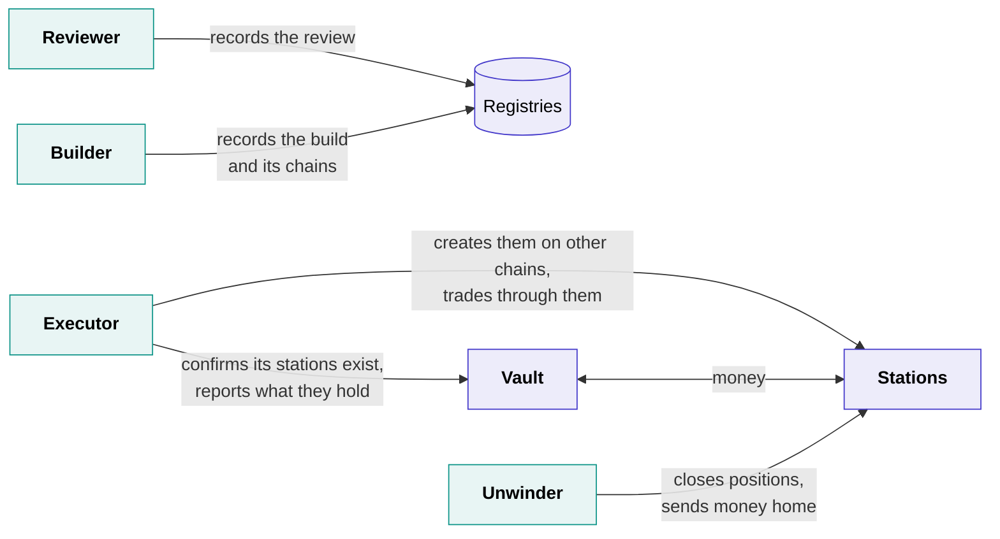

# The machines

Four kinds of attested machine run Shonin, all the time, each picking up its own kind of job:

- **The Reviewer** reads an agent's code and writes its report.
- **The builder** compiles an agent's code into the build its vault will run.
- **The executor** runs agents, and trades for their vaults.
- **The unwinder** finishes withdrawals the contracts can't finish alone.

The machines only deal with the registries and the stations, and with the vault only to tell it about its stations: that they're ready, and what they hold. That's also how news crosses from one chain to another. Apart from money over a bridge, everything is carried by these machines, never by an outside messaging service.

## The Reviewer

**Given** an Author's upload, once its 1 USDC is paid. If it's sealed, it decrypts it inside.

**Does:**

1. Unpacks the zip carefully, refusing anything that would land outside the project, any links, and anything over the [size limit](../writing/publishing.md#sanity-check), however small the zip.
2. Fingerprints the source itself. It never trusts a fingerprint from outside.
3. Reads it with the pinned AI model and the pinned instructions, and answers the fixed questions that set each area's rating.
4. Writes the report.

Everything that shapes a review is **pinned in the Reviewer's image**: the model, the instructions, the questions and how their answers become ratings. Changing any of it means a new image, with the same public wait as any other. The instructions and questions are published, so an Author can run the same review against any model before publishing; it just isn't signed, so it doesn't count.

**Records** the review on the chain once the builder has registered the build, signed with its blessed key. The record ties together the exact source it read, the exact build made from it, the image and model that did the reading, the report as published, and the six ratings. Our contracts accept it only from a blessed Reviewer, and only if its source and build match the agent's. So a good rating can never follow code nobody read.

Each agent is reviewed once. A later Reviewer image doesn't review running agents again.

If the code is malicious, the Reviewer records a refusal instead: which source, which image, and its public report. Nothing is built.

**Can't** build, trade or move money.

## The builder

**Given** the same upload, once the review has passed it, and decrypts and unpacks it the same careful way.

**Does:**

1. Fingerprints the source itself, and it must match what the Reviewer read.
2. Compiles it once, offline, with the published recipe: a pinned toolchain, the exact dependency versions the Author committed, and no network.
3. Loads the result in the executor's own runtime to check it works, and packs the build: the compiled agent plus any AI models it ships.
4. Reads `shonin.toml` to learn which drivers, and so which chains, the agent needs.

Anyone can repeat the recipe and get the same fingerprint, as long as the project doesn't reach for the clock, the network or a random number while it compiles. One that does is flagged under reproducibility in its review.

**Records** the build on the chain, signed with its blessed key, together with the agent's id, its Author and the chains it needs, so the signature can't be reused for anything else. When the Author [activates](../writing/publishing.md#activate-it) the agent, its vault and stations are created from that record, so nobody can choose different chains for them.

**Can't** trade, review, or create a vault.

## The executor

**Given** its vaults by our scheduler, and for each one the agent's build and its sealed secrets.

**Does:**

1. Makes a key for each of the vault's venue accounts, inside the machine.
2. Has them [blessed](attestation.md#blessing-a-key) for the vault and the build it will run, on every chain the agent trades on.
3. For a newly activated vault, creates its stations on the other chains, then confirms to the vault that every one exists. Until then the vault stays closed.
4. Has its keys approved at each venue as trade-only.
5. Runs the agent in its sandbox, and signs the orders the agent hands it, only ever for the vault's own accounts.
6. Reports to the vault what each station on another chain holds, as the station itself works it out on its own chain, signed with its blessed key.
7. Keeps the signed running total of what the agent uses, which the [tank](../tank.md) pays, and publishes a signed [health report](#health-reports).

Creating stations is safe to repeat. Each station's address is fixed in advance from its vault, and the contracts on each chain only create it for a key blessed as this vault's executor, so if an executor stops partway, the next one simply carries on. A vault that's still not whole after three days can be cancelled by anyone: it never took a deposit, and its tank goes back to the Author.

A standby executor elsewhere holds its own keys for the same vault, ready to take over. Only one executor's keys are ever approved at a time, so the two can never both trade.

**Can't** withdraw. The venue and the station both refuse it, whatever the executor's code says.

### What the executor enforces

The agent runs inside a WebAssembly sandbox with real limits:

| Limit | How |
| --- | --- |
| Fairness | The sandbox takes control back every few milliseconds, whatever the agent is doing, so no agent can starve another |
| Allowances | Computing, memory and the rest are capped at the allowances the Author set, and follow them when they change |
| Usage | Everything the agent uses, gas included, goes on the running total, and the agent stops when the unpaid part reaches what's in the tank |
| Faults | An agent that crashes is started again, and every restart shows in the health report |

## The unwinder

A separate, smaller image with no agent in it at all. It exists for the venues where the contracts can't finish a withdrawal by themselves, such as a station on another chain whose money has to be bridged home, or a venue whose accounts live off-chain. Any approved operator can run one, not only us.

**Given** a booked withdrawal, a kill or a retirement to finish.

**Does** close the vault's positions there with reduce-only orders, inside the exit band, and send the money only to the vault's own addresses. It can also report what a station holds to the vault, just as the executor does, so a withdrawal doesn't depend on the executor. On a venue whose accounts can only be read through its own service, it reads the account and signs its value, so the station can report it.

**Is repaid** for its gas and bridge fees from the money it brings home, never from the tank. For a withdrawal, that's the leaver's own money. A kill or a retirement is everyone leaving at once, so everyone pays their share.

**Can't** run an agent, open a position, or send money anywhere but home.

## Health reports

The executor publishes a signed health report for each vault: restarts, faults, refused orders, venue errors, and what's left in the tank. It's signed with the vault's own blessed key, and Shonin shows no report signed by any other, so what you see comes from the machine actually running the vault.

It's there to show how things are running, never as the record of what the agent did. That record is on the chain, where nobody can rewrite it, and nothing a Depositor needs in order to leave depends on a health report.

## At a glance

| | Reviewer | Builder | Executor | Unwinder |
| --- | --- | --- | --- | --- |
| **Given** | The upload | The upload, after the review | Its vaults' builds and secrets | Withdrawals, kills and retirements to finish |
| **Decrypts** | Sealed source | Sealed source | Its agents' sealed builds and secrets | Nothing sealed |
| **Records or signs** | The review | The build, and the chains it needs | Orders, that the stations exist and what they hold, the running total, health reports | Reduce-only closes, what stations and accounts hold |
| **The chain checks** | A blessed Reviewer, matching source and build | A blessed builder | A key blessed for this vault and build | A key blessed for this vault, as an unwinder |
| **Can't** | Build, trade, move money | Trade, review, create a vault | Withdraw | Run an agent, send money anywhere but home |

[Next: vaults →](vaults.md){ .md-button .md-button--primary }
