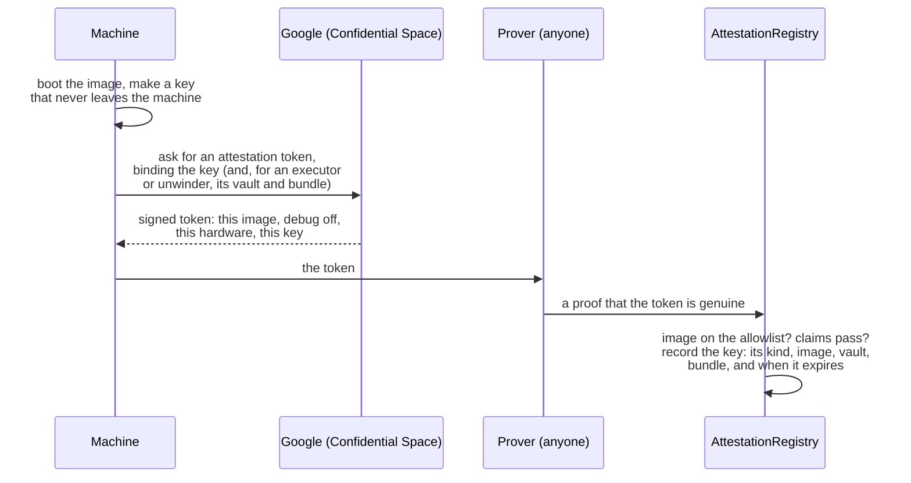
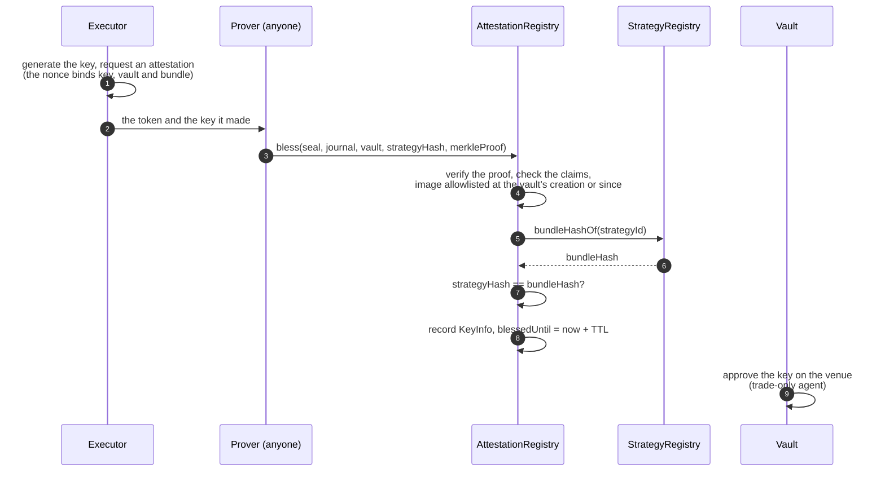

# How the machines work

Four kinds of attested machine run Shonin: the **Reviewer**, the **builder**, the **executor** and the **unwinder**. Each runs its own image, proves which image it is, and can only do its own job. This page follows each one through: what it receives, what it holds, what it signs, and what the chain checks.

## What attestation proves, and what it doesn't

Attestation proves **which code** a machine is running. It does not watch what that code does from moment to moment. So the promise behind every machine is the same, in two parts:

1. **Only an approved image can hold a key or read a secret.** The chain checks this every time.
2. **What an approved image does is what its published code does.** Every image is open source, rebuildable to the same digest, and only counts two days after it's added to the allowlist, so anyone can read it before it runs. The wait can be raised at once, but lowering it takes as long as the current wait, so it can never be cut quietly.

So "only our attested machines can read sealed source" means: the source is encrypted so that only machines proving an allowlisted image can decrypt it, and those images' published code says what happens to it. The one place it leaves an attested machine is the AI model the Reviewer consults, a hosted service whose terms rule out training on it or keeping it.

## What every machine does first

Whatever its job, a machine starts the same way:



- **The key is made inside the machine** and never leaves it, so whoever runs the machine, us included, never sees it.
- **Google signs the token**, not us. It names the exact image, and that debugging is off, so nobody can read the machine's memory.
- **Anyone can be the prover.** The registry checks the proof, not who sent it.
- **Every key has a kind.** An image is allowlisted as a Reviewer, builder, executor or unwinder, and a key from it can only do that kind's job. A builder key can't post a review, and a Reviewer key can't trade.
- **Blessings expire** after 72 hours, and a machine renews by attesting again. Revoking an image stops its keys at once.

## The root key: how sealed things stay sealed

Everything sealed (an Author's source, a sealed bundle, an agent's secrets) is encrypted under keys derived from one **root key**. The root key exists only inside attested machines.

- **It passes only by attested key exchange.** A machine holding the root key hands it to another only if that machine proves an allowlisted image, the same check as a blessing. Adding an image takes two days and is public, so who could ever receive the root key is visible in advance.
- **There's no way to export it.** No cloud key service, no administrator setting, no export path in any image.
- **Each image only derives what its job needs:**

| Image | What it can decrypt |
| --- | --- |
| Reviewer | Sealed source, to read it |
| Builder | Sealed source, to compile it |
| Executor | The sealed bundles and secrets of the agents it runs, and nothing else |
| Unwinder | Nothing sealed; it never sees an agent's code |

## The Reviewer

**Receives** an Author's upload, once the publishing deposit is paid. If it's sealed, it decrypts it inside.

**Does:**

1. Hashes the source itself. It never takes a hash from outside.
2. Reads it with the pinned AI model, using the pinned instructions, and answers the fixed questions that set each area's rating.
3. Writes the report.

**Pins**, in its image, the model, the prompt and the output schema, the questions and their thresholds, and the six areas, four ratings and three severities. Changing any of them is an image change, which goes through the same public, timelocked [allowlist](#the-allowlist) as any other. The prompt, the schema and the questions are published, so an Author can run the same review against any model before publishing; it just isn't signed, so it isn't binding.

**Signs** the review with its blessed key, once the bundle is registered. The review registry accepts it only from a key blessed as a Reviewer on an allowed image, and only if its source and bundle hashes match the agent registered:

```solidity
submitReview(strategyId, Review(
    bytes32  bundleHash,       // the bundle reviewed
    bytes32  sourceHash,       // the source the reviewer read
    bytes32  reviewerImage,    // the image it ran in
    bytes32  modelIdHash,      // the pinned model
    bytes32  promptHash,       // the prompt, the schema and the questions together
    bytes32  reportHash,       // the report as published
    uint8[6] ratings,          // one per area: fine, some concerns, serious, couldn't tell
    uint16   findingCount,
    uint64   reviewedAt
))
```

A review covers one source and the one bundle built from it, so a good rating can never follow code nobody read. Each agent is reviewed once, and a later Reviewer image doesn't review running agents again.

A refusal is recorded instead, in the transaction that returns the deposit: the source hash, the Reviewer's image and the hash of its public report. Nothing is built.

**Holds** a credential for the hosted AI model, which only the Reviewer image can obtain.

**Can't** build, trade or move money.

## The builder

**Receives** the same upload, once the review has passed it, and decrypts it if it's sealed.

**Does:**

1. Hashes the source itself, which must match the Reviewer's.
2. Compiles it once, offline, with the published recipe.
3. Loads the result to check it works, and assembles the bundle.
4. Reads the manifest to learn which venues, and so which chains, the agent needs.

The recipe is fixed and published, so anyone can repeat it: a pinned toolchain and the builder's own copy of the SDK, `--locked` so the dependency graph is the one the Author committed, and the `wasm32-wasip2` target, for which `rustc` emits the component itself. The component is then loaded in the executor's own runtime, to check it satisfies the interface before anything is registered, and the bundle, the component plus any models the project ships, is assembled and hashed.

!!! note "Why not build it twice and compare?"
    Because it would prove less than it looks. Two builds on the same machine, seconds apart, differ in almost nothing, so they test the easy cases and not the ones that break someone else's rebuild. Reproducing a bundle elsewhere comes from a hermetic recipe: a pinned image, fixed paths, a fixed timestamp, no network. A project that reaches for a clock, the network or a random number while it compiles is a finding under reproducibility.

**Signs** "this source and manifest → this bundle", together with the chain, the registry, the agent's id and its Author, so the signature can't be reused for anything else. The strategy registry accepts a bundle only with a signature from a key blessed as a builder.

**Then creates the vault.** In the same step as registering the bundle, the builder's key creates the vault on the home chain and the vault's own accounts on every other chain it trades, and moves the deposit, less the $1, into the tank. These are transactions, and their gas comes out of the deposit. If the build fails, the builder returns the deposit instead, less the $1 and the gas to send it.

**Can't** trade, review, or touch a vault once it's created.

## The executor

**Receives** its vaults from our scheduler, and for each one the agent's bundle and its sealed secrets, which only it can decrypt.

**Does:**

1. Makes one key for each of the vault's venue accounts, inside the machine.
2. Attests, binding those keys to the vault and to the bundle it will run. The registry blesses them only if that bundle is exactly the one registered for the vault's agent.
3. Once blessed, the vault approves the keys at each venue with the narrowest powers the venue offers: trade, never withdraw.
4. Runs the agent in its sandbox, signing the orders it submits, but only for the vault's own accounts.
5. Keeps the signed running total of usage and gas that the tank pays, and publishes a signed health report.

**Holds** the vault's trading keys, and a standby executor in another zone holds its own, ready to take over.

**Can't** withdraw. The venue and the vault contract refuse it, whatever the executor's code says.

## The unwinder

A separate, smaller image with no agent in it at all. It exists for the venues a vault's contract can't reach by itself, and any allowlisted operator can run it, not only us.

**Receives** a booked withdrawal, a kill or a retirement to serve.

**Does** close the vault's positions there with reduce-only orders, inside the exit band, and send the cash only to the vault's own address. On exchanges that can only be read through their own API, it reads the account and signs its value, so the vault can price it.

**Holds** keys blessed for the vaults it serves, with the narrowest powers each venue offers. Its costs are repaid from the withdrawal it serves, never from the tank.

**Can't** run an agent, open a position, or send money anywhere but home.

## Blessing a key

No key trades until our contracts have verified its attestation. The attestation registry checks the proof and records the key; the vault approves it at the venue only if the registry says it belongs to this vault and this bundle; and the venue accepts orders only from keys the vault approved. When the blessing lapses or the image is revoked, anyone can have the approval withdrawn.



The executor generates its key inside the enclave and asks for an attestation token whose nonce commits to the pairs of vault and bundle it holds keys for. Verifying that token on-chain directly would be expensive, so the check runs inside a zero-knowledge guest that commits a compact journal (the image, the project, the key, the nonce), and a proof of that execution is what the registry verifies.

**Anyone can be the prover.** The proof is what the registry checks, not who sent it.

What gets recorded:

```solidity
struct KeyInfo {
    bytes32   imageDigest;   // the image the key was generated in
    ImageKind kind;          // Executor, Unwinder, Builder or Reviewer
    bytes32   strategyHash;  // the bundle it may run
    address   vault;         // the one vault it may act for
    bytes32   trustRoot;     // what the proof was checked against
    uint64    blessedUntil;  // expiry; attest again to renew
}
```

- **One key, one vault, one agent.** A key blessed for vault A cannot trade or move capital for vault B. A vault's agent never changes, so neither does what its keys may run.
- **Time-limited.** A blessing lasts a fixed period, 72 hours by default, and the executor renews by attesting again.
- **Kinds are separate.** An image is allowlisted as one kind, and a key blessed from it can only do that kind's job. A key from a builder image cannot post a review.
- **Approval follows blessing, permissionlessly.** Anyone may send the vault's `approveKey`, and it succeeds only if the registry says that key belongs to this vault and this bundle on an allowed image. Anyone may send `revokeKey`, and it succeeds only for a key whose blessing has lapsed or whose image was revoked.

## The allowlist

The registry keeps the list of images that may hold a key at all (executors, unwinders, the build service and the Reviewer), and the operator projects that may run them.

- **Adding is slow and public.** A new image digest can be proposed at any time, and becomes blessable only after a timelock, two days once outside money is at stake. During that window anyone can rebuild the image from its published source and check the digest, and object. The wait is enforced by the registry contract itself: raising it takes effect at once, and lowering it takes as long as the current wait, so it can't be cut quietly. Every vault's page shows the current wait.
- **Removing is instant.** A revoked image stops being blessable immediately.
- **Shonin's admin key governs the list**, and beyond that it can only kill a vault, described in [The vault contract](vaults.md#a-kill). It cannot bless keys, move funds anywhere but back to Depositors, or change a vault's agent.

## Adding a venue

A new venue needs a new executor image, with the venue's adapter in it, and that image waits its turn like any other. It never means downtime:

1. The new image is proposed, and its wait starts, in public.
2. Every running vault keeps trading on the image it has.
3. When the wait is over, executors move to the new image by failover: a standby on the new image takes over each vault, with no gap.
4. From then on, agents can be published that trade the new venue.

## Updating our own code

The **agent** never changes: it is what the Depositor chose.

The **executor** is our code, and it has to be patchable: a runtime fix has to be able to reach a running vault. What bounds that power is the timelock, a reproducible image, and instant revocation. A running vault adopts a new image by failover: a standby on the new image is blessed and takes over, with the vault's own on-chain approval as the handoff.

Nobody needs a special exit window for it, because you can withdraw at any time. The timelock exists so that outsiders can rebuild the image and object before anyone runs it.

## What the executor enforces

An agent runs inside a WebAssembly runtime with real limits:

| Limit | How |
| --- | --- |
| Fairness | The runtime takes control back every few milliseconds whatever the agent is doing, so no agent can starve another |
| Memory | Capped by a resource limiter at the agent's declared allowance |
| Compute | The declared fuel rate is what the vault's tank is billed for, and how often the agent yields |
| Faults | An agent that traps is torn down and started again, and the restart is counted in the vault's health report |

## Revocation is a halt

If an image is revoked for cause:

1. its keys stop being honoured by the registry and by every vault;
2. each affected vault's venue approvals are revoked;
3. a standby on another allowed image takes over, and if there is none, the vault stops trading, which shows as an error on its page.

The admin key can kill a vault, which flattens positions and pays every Depositor out. Depositors can exit on their own without waiting for anyone.

A vault **never** resumes on a runtime its Depositors did not accept. Revocation can halt an agent. It cannot hand the keys to someone else.

## Health reports

The executor publishes a signed health report per vault: restarts, faults, refused submissions, venue errors, and what the tank has left. It is signed by the key the registry blessed for that vault, over a canonical encoding of the report, and the API refuses one from any other key, so the page repeats the instance, not whoever spoke last.

It is operational evidence, never the record of what the agent did. That is on the chain, where nobody can backfill it. Nothing a Depositor needs in order to leave depends on a health report.

## At a glance

| | Reviewer | Builder | Executor | Unwinder |
| --- | --- | --- | --- | --- |
| **Receives** | The upload | The upload, after the review | Its vaults' bundles and secrets | Withdrawals, kills and retirements to serve |
| **Decrypts** | Sealed source | Sealed source | Its agents' sealed bundles and secrets | Nothing sealed |
| **Signs** | The review | Source → bundle, and the vault's creation | Orders, the usage total, health reports | Reduce-only closes, account values |
| **The chain checks** | Reviewer key, allowed image, matching hashes | Builder key, allowed image | Blessed for this vault and this bundle | Blessed for this vault, unwinder kind |
| **Can't** | Build, trade, move money | Trade, review | Withdraw | Run an agent, send money anywhere but home |
