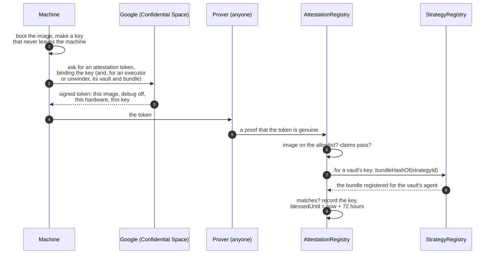

# How the machines work

Four kinds of attested machine run Shonin: the **Reviewer**, the **builder**, the **executor** and the **unwinder**. Each runs its own image, proves which image it is, and can only do its own job. This page follows each one through: what it receives, what it holds, what it signs, and what the chain checks.

## What attestation proves, and what it doesn't

Attestation proves **which code** a machine is running. It does not watch what that code does from moment to moment. So the promise behind every machine is the same, in two parts:

1. **Only an approved image can hold a key or read a secret.** The chain checks this every time.
2. **What an approved image does is what its published code does.** Every image is open source, rebuildable to the same digest, and only counts after a public wait on the [allowlist](#the-allowlist), so anyone can read it before it runs.

So "only our attested machines can read sealed source" means: the source is encrypted so that only machines proving an allowlisted image can decrypt it, and those images' published code says what happens to it. The one place it leaves an attested machine is the AI model the Reviewer consults, a hosted service whose terms rule out training on it or keeping it.

## Blessing a key

Whatever its job, a machine starts the same way: it makes a key, proves which image made it, and has our contracts record it. That record is the key's **blessing**, and no key does anything until it has one.



- **The key is made inside the machine** and never leaves it, so whoever runs the machine, us included, never sees it.
- **Google signs the token**, not us. It names the exact image, and that debugging is off, so nobody can read the machine's memory.
- **Anyone can be the prover.** Checking Google's token directly on-chain would be expensive, so the check runs inside a zero-knowledge program, and the registry verifies a proof of that run. It checks the proof, not who sent it.
- **Every key has a kind.** An image is allowlisted as a Reviewer, builder, executor or unwinder, and a key from it can only do that kind's job. A builder key can't post a review, and a Reviewer key can't trade.
- **Blessings expire** after 72 hours, and a machine renews by attesting again. Revoking an image stops its keys at once.

What gets recorded:

```solidity
struct KeyInfo {
    bytes32   imageDigest;   // the image the key was made in
    ImageKind kind;          // Executor, Unwinder, Builder or Reviewer
    bytes32   strategyHash;  // for a vault's key, the bundle it may run
    address   vault;         // for a vault's key, the one vault it may act for
    bytes32   trustRoot;     // what the proof was checked against
    uint64    blessedUntil;  // expiry; attest again to renew
}
```

An executor's or unwinder's key belongs to **one vault and one agent**. A key blessed for vault A can't trade or move money for vault B, and since a vault's agent never changes, neither does what its keys may run.

A blessing alone doesn't reach an exchange. The vault has to approve the key there, and **anyone may ask it to**: the vault's `approveKey` succeeds only if the registry says the key belongs to this vault and this bundle, on an allowed image. Likewise anyone may send `revokeKey`, which succeeds only once the key's blessing has lapsed or its image was revoked. The exchange accepts orders only from keys the vault approved.

## The root key: how sealed things stay sealed

Everything sealed (an Author's source, a sealed bundle, an agent's secrets) is encrypted under keys derived from one **root key**. The root key exists only inside attested machines.

- **It passes only by attested key exchange.** A machine holding the root key hands it to another only if that machine proves an allowlisted image, the same check as a blessing. Adding an image is slow and public, so who could ever receive the root key is visible in advance.
- **There's no way to export it.** No cloud key service, no administrator setting, no export path in any image.
- **Each image only derives what its job needs:**

| Image | What it can decrypt |
| --- | --- |
| Reviewer | Sealed source, to read it |
| Builder | Sealed source, to compile it |
| Executor | The sealed bundles and secrets of the agents it runs, and nothing else |
| Unwinder | Nothing sealed; it never sees an agent's code |

## The Reviewer

**Receives** an Author's upload, once its $1 is paid. If it's sealed, it decrypts it inside.

**Does:**

1. Unpacks the zip carefully, refusing anything that would unpack outside the project, links, or more than the [size limit](../writing/publishing.md#sanity-check), however small the zip itself.
2. Hashes the source itself. It never takes a hash from outside.
3. Reads it with the pinned AI model, using the pinned instructions, and answers the fixed questions that set each area's rating.
4. Writes the report.

**Pins**, in its image, the model, the prompt and the output schema, the questions and their thresholds, and the six areas, four ratings and three severities. Changing any of them is an image change, which goes through the same public wait on the [allowlist](#the-allowlist) as any other. The prompt, the schema and the questions are published, so an Author can run the same review against any model before publishing; it just isn't signed, so it isn't binding.

**Holds** a credential for the hosted AI model, which only the Reviewer image can obtain.

**Signs** the review with its blessed key, once the [builder](#the-builder) has registered the bundle. The review registry accepts it only from a key blessed as a Reviewer on an allowed image, and only if its source and bundle hashes match the agent registered:

```solidity
submitReview(strategyId, Review(
    bytes32  bundleHash,       // the bundle reviewed
    bytes32  sourceHash,       // the source the reviewer read
    bytes32  reviewerImage,    // the image it ran in
    bytes32  modelIdHash,      // the pinned model
    bytes32  promptHash,       // the prompt, the schema and the questions together
    bytes32  reportHash,       // the report as published
    uint8[6] ratings,          // one per area: fine, some concerns, serious, couldn't tell
    uint16   findingCount,
    uint64   reviewedAt
))
```

A review covers one source and the one bundle built from it, so a good rating can never follow code nobody read. Each agent is reviewed once, and a later Reviewer image doesn't review running agents again.

A refusal is recorded instead: the source hash, the Reviewer's image and the hash of its public report. Nothing is built.

**Can't** build, trade or move money.

## The builder

**Receives** the same upload, once the review has passed it, and decrypts and unpacks it the same careful way.

**Does:**

1. Hashes the source itself, which must match the Reviewer's.
2. Compiles it once, offline, with the published recipe.
3. Loads the result to check it works, and assembles the bundle.
4. Reads `shonin.toml` to learn which drivers, and so which chains, the agent needs.

The recipe is fixed and published, so anyone can repeat it: a pinned toolchain and the builder's own copy of the SDK, `--locked` so the dependency graph is the one the Author committed, and the `wasm32-wasip2` target, for which `rustc` emits the component itself. The component is then loaded in the executor's own runtime, to check it satisfies the interface before anything is registered, and the bundle, the component plus any models the project ships, is assembled and hashed.

!!! note "Why not build it twice and compare?"
    Because it would prove less than it looks. Two builds on the same machine, seconds apart, differ in almost nothing, so they test the easy cases and not the ones that break someone else's rebuild. Reproducing a bundle elsewhere comes from a hermetic recipe: a pinned image, fixed paths, a fixed timestamp, no network. A project that reaches for a clock, the network or a random number while it compiles is a finding under reproducibility.

**Signs** "this source and `shonin.toml` → this bundle", together with the chain, the registry, the agent's id and its Author, so the signature can't be reused for anything else. The strategy registry accepts a bundle only with a signature from a key blessed as a builder.

**Registers** the bundle with that signature, along with the chains `shonin.toml` says the agent needs. When the Author later [activates](../writing/publishing.md#activate-it) the agent, the vault is created from that record, so the Author can't choose different chains for it.

**Can't** trade, review, or create a vault.

## The executor

**Receives** its vaults from our scheduler, and for each one the agent's bundle and its sealed secrets, which only it can decrypt.

**Does:**

1. Makes one key for each of the vault's exchange accounts, inside the machine.
2. Has them [blessed](#blessing-a-key) for the vault and the bundle it will run.
3. Once they're blessed, the vault approves the keys at each exchange with the narrowest powers the exchange offers: trade, never withdraw.
4. Runs the agent in its sandbox, signing the orders it submits, but only for the vault's own accounts.
5. Keeps the signed running total of usage and gas that the tank pays, and publishes a signed [health report](#health-reports).

**Holds** the vault's trading keys, and a standby executor in another zone holds its own, ready to take over.

**Can't** withdraw. The exchange and the vault contract refuse it, whatever the executor's code says.

### What the executor enforces

An agent runs inside a WebAssembly runtime with real limits:

| Limit | How |
| --- | --- |
| Fairness | The runtime takes control back every few milliseconds whatever the agent is doing, so no agent can starve another |
| Allowances | Computing, memory and the rest are capped at the allowances the Author set on the vault, and follow them when they change |
| Usage | Everything the agent uses, gas included, goes on the running usage total, and the agent stops when the unpaid part reaches what's in the tank |
| Faults | An agent that traps is torn down and started again, and the restart is counted in the vault's health report |

## The unwinder

A separate, smaller image with no agent in it at all. It exists for the exchanges a vault's contract can't reach by itself, and any allowlisted operator can run it, not only us.

**Receives** a booked withdrawal, a kill or a retirement to serve.

**Does** close the vault's positions there with reduce-only orders, inside the exit band, and send the cash only to the vault's own address. On exchanges that can only be read through their own API, it reads the account and signs its value, so the vault can price it.

**Holds** keys blessed for the vaults it serves, with the narrowest powers each exchange offers.

**Is repaid**, for its gas and bridge fees, from the money it brings home, never from the tank. For a withdrawal that's the leaver's own claim. A kill or a retirement is a claim for every Depositor at once, and each pays its share.

**Can't** run an agent, open a position, or send money anywhere but home.

## The allowlist

The registry keeps the list of images that may hold a key at all (Reviewers, builders, executors and unwinders), and the operator projects that may run them.

- **Adding is slow and public.** A new image digest can be proposed at any time, and becomes blessable only after a timelock, two days once outside money is at stake. During that window anyone can rebuild the image from its published source, check the digest, and object.
- **The wait can't be cut quietly.** It's enforced by the registry contract itself: raising it takes effect at once, and lowering it takes as long as the current wait. Every vault's page shows the current wait.
- **Removing is instant.** A revoked image stops being blessable immediately.
- **Shonin's admin key governs the list**, and beyond that it can only [kill a vault](vaults.md#a-kill). It cannot bless keys, move funds anywhere but back to Depositors, or change a vault's agent.

## Changing our own images

The **agent** never changes: it is what the Depositor chose. Our own images do, because a runtime fix has to be able to reach a running vault, and a new driver needs a new executor image with the driver in it. What bounds that power is the timelock, a reproducible image, and instant revocation.

A new image never means downtime:

1. It's proposed, and its wait starts, in public.
2. Every running vault keeps trading on the image it has.
3. When the wait is over, a standby on the new image is blessed and takes over each vault, with the vault's own on-chain approval as the handoff.
4. For a new driver, agents that use it can be published from then on.

Nobody needs a special exit window for any of this, because Depositors can withdraw at any time. The wait exists so that outsiders can rebuild the image and object before anyone runs it.

## Revocation is a halt

If an image is revoked for cause:

1. its keys stop being honoured by the registry and by every vault;
2. each affected vault's exchange approvals are revoked;
3. a standby on another allowed image takes over, and if there is none, the vault stops trading, which shows as an error on its page.

A vault **never** resumes on a runtime its Depositors did not accept. Revocation can halt an agent. It cannot hand the keys to someone else.

From a halted vault, Depositors can still exit on their own, without waiting for anyone, and the admin key can kill it, which flattens its positions and pays every Depositor out.

## Health reports

The executor publishes a signed health report per vault: restarts, faults, refused submissions, exchange errors, and what the tank has left. It is signed by the key the registry blessed for that vault, over a canonical encoding of the report, and Shonin refuses one from any other key, so the page repeats the machine running the vault, not whoever spoke last.

It is operational evidence, never the record of what the agent did. That is on the chain, where nobody can backfill it. Nothing a Depositor needs in order to leave depends on a health report.

## At a glance

| | Reviewer | Builder | Executor | Unwinder |
| --- | --- | --- | --- | --- |
| **Receives** | The upload | The upload, after the review | Its vaults' bundles and secrets | Withdrawals, kills and retirements to serve |
| **Decrypts** | Sealed source | Sealed source | Its agents' sealed bundles and secrets | Nothing sealed |
| **Signs** | The review | Source → bundle, and the chains it needs | Orders, the usage total, health reports | Reduce-only closes, account values |
| **The chain checks** | Reviewer key, allowed image, matching hashes | Builder key, allowed image | Blessed for this vault and this bundle | Blessed for this vault, unwinder kind |
| **Can't** | Build, trade, move money | Trade, review | Withdraw | Run an agent, send money anywhere but home |
