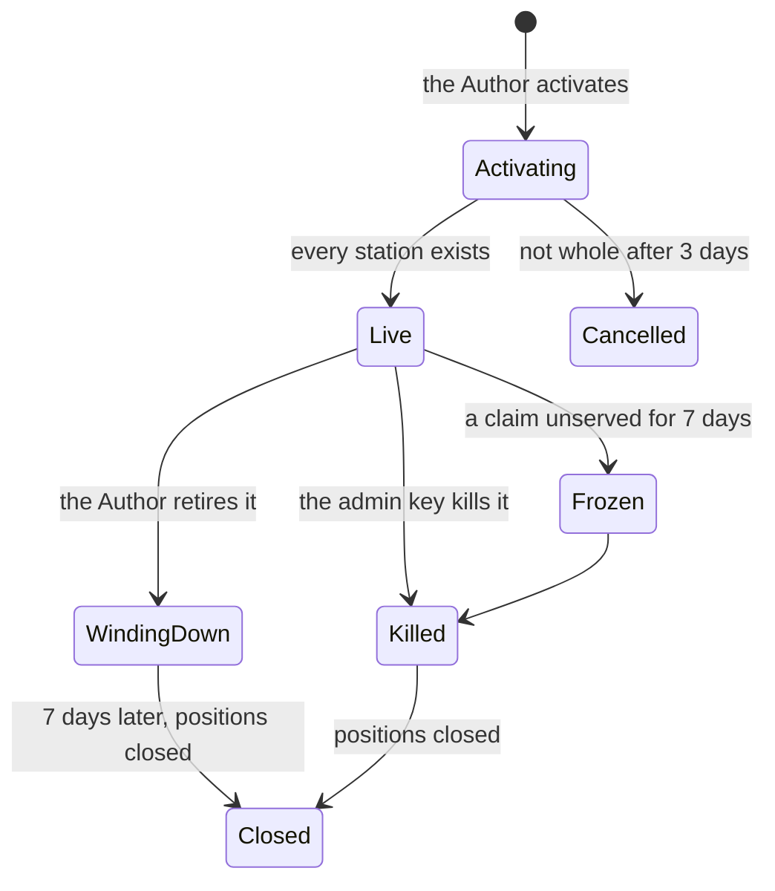
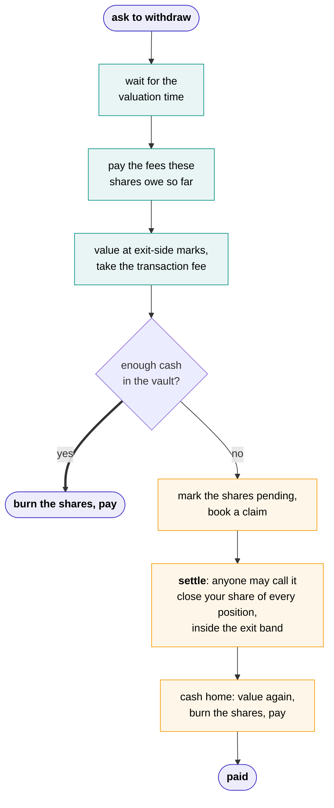

# Vaults

A vault is the one contract behind each agent that Depositors deal with. It lives on the chain its Author chose, takes deposits, pays withdrawals, issues shares, charges fees and holds the [tank](../tank.md). It never trades: its [stations](stations.md) do. It works out its own share price, from its own cash and what its stations hold. For a station on another chain, that figure is carried to it by our attested machines.

## Its life



| State | Deposits | Withdrawals | The agent |
| --- | --- | --- | --- |
| **Activating** | No | Nothing to withdraw | Not started, while its stations are created |
| **Live** | Yes | Yes | Running |
| **Winding down** | No | Yes | Running, for 7 days |
| **Frozen** | No | Yes | Only unwinding is left |
| **Killed** | No | Yes, once the positions are closed | Stopped |
| **Closed** | No | Yes, from cash, whenever anyone likes | Stopped for good |
| **Cancelled** | Never took any | Nothing to withdraw; the tank goes back to the Author | Never started |

A vault never changes its agent. A changed agent is a new agent, with a vault of its own.

## Shares

A deposit mints shares at the vault's value per share, and a withdrawal burns them. Your profit or loss is your shares times today's value per share, less what you paid.

On Ethereum-style chains, a vault's shares use **ERC-4626**'s maths and its deposit and withdraw calls. On Solana, the vault is a Solana program with the same rules. On every chain, **shares can't be transferred**: you get money out by withdrawing.

Whoever is moving pays for the move, never the pool:

| Moving | Valued at |
| --- | --- |
| Depositing | Mark |
| Withdrawing | Exit-side marks: a long at the best bid, a short at the best ask |

**An empty vault can't be gamed.** A classic trick against a new vault is to deposit a tiny amount, then send the vault a large sum directly, so the next depositor's shares round down to nothing. It doesn't work here: the share maths always counts a small number of phantom shares, a vault only counts money that came in through its own deposits and its stations, and a sliver of shares that nobody can withdraw is created when the vault is activated.

## Priced after you ask

**Every deposit and withdrawal is a request, priced a few seconds after you make it.** When you ask, the vault records your request and a **valuation time**: the first ten-second mark at least five seconds away. You're then valued at the prices at that moment, never at a price that was already known when you asked. Nobody, you included, can see that price when committing to it, so nobody can race the vault's own figure with news from elsewhere.

- **A request can't be cancelled.** Otherwise it would be a free bet: ask, then cancel if the price moved the wrong way.
- **Which prices count is fixed by a rule, not by whoever settles.** Prices on the vault's own chain must be recorded within three seconds after the valuation time. A station on another chain is valued at that chain's first block at or after it, and an attested machine carries that figure to the vault within the next minute, signed with a key blessed for this vault. If nothing is recorded in time, the request moves to the next valuation time.
- **Requests for the same moment are settled together,** at one price.
- **If two carried figures for the same moment disagree,** deposits use the higher and withdrawals the lower, so a wrong figure can't help anyone take money from the pool.

The web app does both steps for you, and a deposit or withdrawal paid from cash is still done within seconds. The smallest deposit is $10.

**A deposit carries a signed statement.** The depositor's wallet signs that they aren't one of the people this vault excludes and aren't acting for one. The vault works out its list from its drivers, plus US persons and sanctioned persons, plus anything its Author added; it checks the signature against that list, records it, and refuses a deposit without one, however the deposit arrives. A withdrawal never needs one. [Depositors](../depositors.md#who-can-deposit) and [Drivers](../writing/drivers.md#who-a-venue-excludes) have the rest.

!!! note "Not quite ERC-4626"
    Deposits and withdrawals settle after a request, in the manner of ERC-7540. Anything integrating with a vault should expect that.

## Its value

```text
vault value = cash in the vault
            + what each station holds
            − the tank (the Author's money for running the agent, not Depositors')
```

The vault reads a station on its own chain directly. A station on another chain works out what it holds from its own chain, and an attested machine carries the figure to the vault. [Stations](stations.md#what-its-worth) explains how each is valued. Money crossing a bridge counts for up to an hour, then as zero until it arrives.

## Leaving



**Most withdrawals are paid from cash.** Each vault keeps some of its money at home as cash, its **idle floor**: 5% by default, set by the Author, and enforced by the vault, which won't let money out to its stations if that would leave less. Lowering the floor takes a day, so Depositors see it coming.

**When there isn't enough cash,** the shares are marked pending and the vault books a **claim**. It's settled by closing the leaver's share of every position and bringing the cash home, and then they're paid. A claim is *pending*, *waiting* if the market was outside the exit band when settling was tried, or *paid*.

**Settling needs nobody's permission.** `settle` is public: if everything we run stopped this minute, a Depositor could send it themselves. On the vault's own chain the contracts finish it alone. Where a station is on another chain, or a venue keeps its accounts off-chain, an [unwinder](machines.md#the-unwinder) finishes it. Any approved operator can run one, though at launch that's only us. Each vault's page says which kind of vault it is, **direct** or **served**, and [Stations](stations.md#getting-money-out) explains the difference.

**If no price can be had at all,** say a station's figure can't be carried because no operator is running, a withdrawal isn't stuck. After 24 hours without a valuation, you can take your exact share of the vault's cash straight away, and the rest of your shares become a claim on the same share of each station's holdings, paid when that money comes home. Nothing needs pricing, so nothing can be gamed, and nobody else in the pool pays for it.

### The exit band

A claim's positions are closed with reduce-only orders that fill at once or not at all, at the venue's oracle price plus or minus the **exit band**, 1% by default. What one leaver can cost the pool beyond the spread is bounded by that band. If the market is outside it, nothing fills, the claim waits, and settling is tried again.

The leaver pays the spread, the transaction fee, and the costs of their own exit, such as an unwinder's gas and bridge fees. The unwinder reports those, signed with its blessed key, and they can never be more than the chain's gas price times published limits for each step, plus the bridge's quoted fee. The leaver also shares the close's impact with everyone else, since their shares are still outstanding when it lands.

**A claim nobody has tried to settle for seven days lets anyone freeze the vault:** no new deposits, the agent's trading keys lose their approval at every station, and only unwinding is left. A claim that's only waiting because the market is outside the exit band doesn't count.

## Fees

Fees are measured at every valuation and paid on the first valuation on or after Monday 00:00 UTC, as **new shares**, so paying them never forces a sale.

```text
at every valuation, what is owed so far is worked out and taken out of value per share:

  holding fee  = value × 1% × (time since the last valuation) / 365 days
  if value (after the holding fee) > high-water mark × shares:
      gains      = value − high-water mark × shares
      author fee = gains × 10%
      platform   = gains × 5%

at the first valuation on or after Monday 00:00 UTC:
  what is owed then is paid as new shares          → the Author, the platform
  high-water mark = value per share, if that is a new high

on every deposit:
  transaction fee = 0.1% of the amount              → stays in the pool
  money joining above the high-water mark joins at its own price:
  the mark becomes the average, so nobody else's fee or price moves

on every withdrawal:
  transaction fee = 0.1% of the amount              → stays in the pool
  the leaver pays the profit fee their own shares owe, with a slice of those shares
```

- **Value per share is always after fees.** What's owed so far is already taken out of the number a Depositor sees, so there's no drop on payday.
- **Fees owed can shrink.** If the vault gives back its gains before the week is out, what it owes shrinks with them. A gain that vanishes within the week is never charged for.
- **The high-water mark is the vault's own:** its highest value per share at a weekly payment, averaged up when money joins above it. Profit fees are only ever taken on new highs, and money that joins never pays for gains it wasn't there for.
- **The transaction fee is nobody's.** It stays in the pool and raises value per share for the Depositors who stay, so timing a deposit or withdrawal around a price update costs the one timing it.

The schedule is fixed when the vault is created and never changes under it. A vault's page shows its own schedule, not today's default.

## The tank

Each vault has a **tank**: a plain dollar balance, held by the vault but not counted in what shares are worth, that pays for running the agent. The Author fills it when activating, and whenever they like after that.

- **What's charged is capped.** The executor keeps a running total of what the agent uses, signed with the vault's own blessed key, and stops the agent the moment the unpaid part reaches the tank. Once a day, `keep` collects it and tops the tank up if the Author asked for that. Anyone may send it; Shonin normally does, and pays its gas. The vault only believes the total up to the Author's allowances at our published prices, for the time that has passed, so a wrong total can never charge more than the Author agreed to.
- **Earnings can pay for it.** The Author's fee shares are theirs. They can turn some into tank money, or set **auto-fill**, "keep my tank at $X", and each day just enough of their shares are turned into cash to top it up. Either way the shares are redeemed like any withdrawal, at the next valuation and only from cash, so nobody else pays for it.
- **The Author can take it out** at any time. The latest bill is paid first, and the rest comes back at once. If no executor is running to sign a bill, the Author asks, waits a day so anyone can collect a final bill, and then takes it out without one.
- **A dry tank stops the agent,** until anyone tops it up. Its positions stay as they are, and the vault's page says so. Withdrawals never draw on the tank, so an empty one can't hold anyone up. A final bill bigger than the tank takes what's there, and the rest is written off.

## Retiring

An Author can **retire** their agent at any time, but it takes a week on purpose. The vault stops taking deposits at once, the agent keeps running, and withdrawals work as usual. After seven days anyone can end it: the agent is sent `halting` and gets ten minutes to wind down, then it's stopped for good, every position is closed the same way a claim closes them, and the cash comes home, its costs paid from the money itself. The vault stays on the chain for good, holding only cash, for anyone still in to withdraw.

## A kill

Shonin's **admin key** can **kill** a vault, typically one whose health report shows it failing. It's the only thing that key can do to a vault. The agent is sent `halting` and gets ten minutes to wind down itself, then every position is closed the same way a claim closes them, and the cash comes home, so every Depositor can then be paid in one transaction.

A kill moves no money anywhere but back to Depositors. It's a halt, never a theft, and every kill is announced on the vault's page and a public feed, with its reason.

## What the chain verifies

| Fact | Checked by the chain | Rests on |
| --- | --- | --- |
| Shares, deposits, withdrawals, claims and how they settled | ✓ | |
| That every depositor signed the vault's statement | ✓ | The depositor's own word: nobody's identity is checked |
| Fees, the high-water mark, the tank and what it was charged | ✓ | Charges are capped at the Author's allowances; within that, the executor's signed total |
| Cash in the vault, and what a station on its own chain holds | ✓ | The prices the station uses |
| What a station on another chain holds | Signed by a key blessed for this vault, and fresh | The attested machine that carried it |
| Which keys may trade for the vault, and what they may run | ✓ | Attestation, through each key's [blessing](attestation.md#blessing-a-key) |

[Next: stations →](stations.md){ .md-button .md-button--primary }
