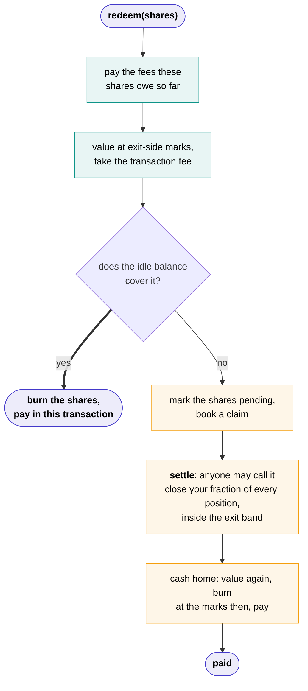

# The vault contract

A vault is one contract holding one pool of capital behind one agent. It computes its own value, mints and burns its own shares, pays its own withdrawals, and charges its own fees. Nobody reports anything to it.

## Shares

Shares follow **ERC-4626**, the standard interface for tokenised vaults: the vault is an ERC-20 whose shares are a pro-rata claim on a pool of one asset, with a share price of assets divided by shares that wallets and other contracts already understand.

A deposit mints shares at the vault's current value per share. Your profit and loss is your shares times today's value per share, less what you paid.

The standard's one fairness rule, round against whoever is moving, is applied to prices as well as to shares:

| Moving | Valued at |
| --- | --- |
| Depositing | Mark |
| Withdrawing | Exit-side marks: a long at the best bid, a short at the best ask |

So the mover pays the spread, and the pool never does.

!!! note "Not fully ERC-4626 compliant"
    `redeem` may book a claim rather than transfer assets, in the manner of ERC-7540. An integrator should expect that.

## Leaving



Each vault keeps some of its money home, in the vault contract itself, rather than out at an exchange. How much is the Author's choice, 5% of the vault by default, and the contract enforces it: it won't let the agent move money out if that would leave less than the Author's floor. Lowering the floor takes a day to apply, so Depositors can see it coming. So most withdrawals end in the first branch: the shares are burned and the Depositor is paid in the same transaction.

When idle capital cannot cover it, the shares are marked pending and the contract books a **claim**, which has three states: *pending*, *waiting* when a settlement was tried and the market was outside the band, and *paid*.

`settle` is a public function, and that is the part worth dwelling on. A Depositor does not need us, or the Author, or the executor, to get their money. If every service we run stopped this minute, they could send the settle transaction themselves and be paid by the contract.

### The exit band

A claim's positions are closed with reduce-only immediate-or-cancel orders, limited to the exchange's oracle price plus or minus the **exit band**, 1% by default. The pool's cost beyond the spread is therefore bounded by that band times the notional closed. If the market is outside the band the close does not fill, the claim waits, and settlement is retried.

The leaver pays the spread through exit-side marks, pays the transaction fee, and bears the close's impact pro rata with everyone else, because their shares are still outstanding when it lands. The Depositors who stay keep the transaction fee.

A claim that goes unserved for seven days lets anyone freeze the vault: no new deposits, and only unwinding left.

## Fees

Fees are worked out every day and paid once a week, as **new shares**, so paying them never forces a sale.

```text
every day, what is owed so far is worked out and taken out of value per share:

  holding fee  = value × 1% × (days since the last payment) / 365
  if value per share (after the holding fee) > high-water mark:
      gains      = (value per share − high-water mark) × shares
      author fee = gains × 10%
      platform   = gains × 5%

once a day, keep() collects the tank's bill, and on the weekly day:
  what is owed then is paid as new shares          → the Author, the platform
  high-water mark = value per share, if that is a new high

on every deposit and withdrawal:
  transaction fee = 0.1% of the amount              → stays in the pool
  a withdrawal pays what its own shares owe so far
```

- **Value per share is always after fees.** What is owed so far is already taken out of the number a Depositor sees, so there is no drop on the day fees are paid.
- **Fees owed can shrink.** If the vault gives back its gains before the week is out, what it owes shrinks with them. Only what is still owed at the weekly payment is paid, so a gain that vanishes within the week is never charged for.
- **The high-water mark is the vault's own.** It is the highest value per share the vault has reached at a weekly payment, so profit fees are only taken on new highs. A loss followed by a recovery pays nothing on the recovery.
- **The transaction fee is nobody's.** It stays in the pool and raises value per share for the Depositors who stay, so timing a deposit or a withdrawal around a price update cannot take value from them.
- **Moving to another agent** costs the transaction fee out and in.

The schedule is fixed when a vault is created and never changes under it. A vault's page shows its own schedule, not today's default.

## The tank

Running an agent costs money: compute, and gas where a chain charges it. That is the **Author's** cost, not the Depositors'.

Each vault has a **tank**, a plain dollar balance for running it. The Author funds it when activating the agent, and whenever they like after that, and it's excluded from what shares are worth, so a Depositor's value never pays for the agent's electricity.

- The executor keeps a running total of usage, signed by the vault's own blessed key, and stops the agent the moment the unpaid part reaches the tank. Once a day, one call to the vault's `keep` collects it from the tank, pays fees on the weekly day, then runs auto-fill. Anyone may send it; Shonin's keeper normally does, and pays its gas. The contract believes the total only up to the allowances the Author declared at the platform's published prices over the time elapsed. A wrong total cannot charge more than the Author agreed to.
- The Author's fee shares are theirs. They can redeem some into the tank in one transaction, or set **auto-fill** to "keep my tank at $X": each day, just enough of their shares are redeemed to bring the tank back to $X, from the vault's idle balance, waiting until the next day when there isn't enough.
- The Author can withdraw from the tank at any time. The withdrawal settles a recent signed usage total first, then transfers the rest at once.
- A tank that runs dry stops the agent until anyone tops it up. Its open positions stay as they are, unmanaged, and the vault page says so; Depositors can leave at any time, and exits never draw on the tank. A last bill the tank can't cover takes what's there, and the rest is written off; the tank never carries a debt.

Every vault page shows the tank's balance and its recent charges.

## Retiring

An Author can **retire** their agent at any time, and it takes effect slowly on purpose. Retiring starts a **wind-down** of seven days: the vault refuses new deposits, the agent keeps running, and every withdrawal works exactly as before. When the wind-down ends, the agent is evicted from the attested machine, and its positions are closed through the same reduce-only path a claim uses and the cash brought home, its costs paid from what comes home, never by the tank or by us. After that, every remaining Depositor is paid from idle balance in one transaction. The vault contract itself stays on-chain, holding only cash, and anyone still in, the Author included, withdraws from it whenever they like.

The tank works as always during the wind-down. If the Author empties it, the agent stops early, and the positions are still closed when the week is up.

## A kill

Shonin's **admin key** can **kill** any vault, typically after its health report shows it failing. Besides proposing and revoking machine images, it's the only other thing that key can do. A kill closes every position through the same reduce-only path a claim uses and brings all the cash home. After that the vault holds only idle balance, so every Depositor's withdrawal is paid in one transaction.

It moves no funds anywhere but back to Depositors. It is a halt, never a theft. Every kill is announced on the vault's page and on a public feed, with its reason.

## What the chain verifies

| Fact | On the chain |
| --- | --- |
| Share supply, deposits, withdrawals, pending shares, claims and their settlement | ✓ |
| Fees, the high-water mark, the tank and what it was charged | ✓ |
| The vault's value, computed by the contract from exchange state | ✓ |
| Which keys may act for the vault, and what they may run | ✓ |
| Every order and fill on the exchange | ✓ |
