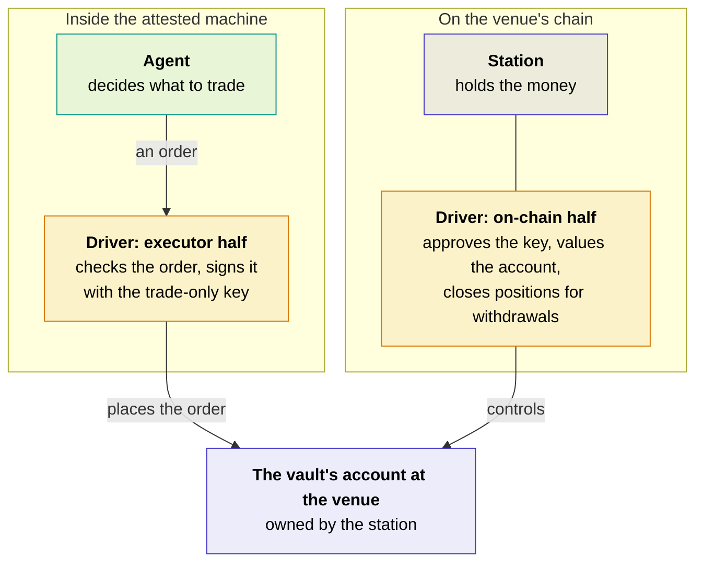

# Drivers

A driver is what lets your agent use one venue. The vault and its [stations](../under-the-hood/stations.md) know nothing about any venue: everything venue-specific lives in its driver, plugged into the station on that venue's chain. So a new venue is a new driver, and nothing else changes.

You choose drivers by name in `shonin.toml`, one `[drivers.<name>]` table each. Depositors never need to think about them: a vault's page just shows the venues it trades on.

## The drivers

| Driver | Name in `shonin.toml` | What it trades | Chain |
| --- | --- | --- | --- |
| Hyperliquid | `hyperliquid` | Perpetuals and spot | Hyperliquid |
| Robinhood Chain stock tokens | `robinhood-stocks` | Tokenised stocks, through approved exchanges on the chain | Robinhood Chain |
| Arcus | `arcus` (coming, once we've confirmed a vault can own an account there) | Stock perpetuals | Robinhood Chain |
| An on-chain game | To be announced | Matches played for stakes | Solana |

Each driver has its own table, named after it, for whatever that driver needs to know. None of the drivers above needs any settings yet, so an empty table is enough:

```toml
[drivers.hyperliquid]
```

As drivers need settings of their own, such as which markets or accounts to use, they'll be listed here, driver by driver.

## Two halves

A driver has two halves that work on the same account: one inside the attested machine, which the agent's orders go through, and one on the chain, which controls the account itself.



| Half | What it does |
| --- | --- |
| **On the chain** | Approves the vault's trade-only keys at the venue once they're [blessed](../under-the-hood/attestation.md#blessing-a-key) for the vault, and withdraws the approval when they're not. Where the station carries out trades itself, checks that each one is only a trade. Works out what the station holds at the venue. Closes positions when someone withdraws, a vault is killed or an agent is retired |
| **In the executor** | Turns the agent's orders into the venue's own, and signs them with the vault's trade-only key, only ever for the vault's own accounts. Streams the account's fills and balances back to the agent, and the venue's public market data to every agent that wants it |

An agent never talks to a venue directly. It builds its orders with the driver's typed library from the SDK, hands them over, and the driver checks and signs them inside the attested machine.

## The promises every driver keeps

Venues work very differently, but a driver only counts if it keeps the same promises for every one of them:

- **Keys can trade, never withdraw.** The vault's keys at the venue can only place and cancel orders.
- **Money only goes to the vault's own accounts,** whatever the key asks for.
- **Holdings are worked out, not reported:** from the venue's on-chain state, or, for a venue that keeps its accounts off-chain, an attested read that the vault's page labels as such.
- **Positions can always be closed** for a withdrawal, by the contracts alone or by an unwinder, and the vault's page says which.

### How money stays in

Something has to stop the vault's keys from sending money anywhere but the vault's own accounts. There are two ways that can happen, and each vault's page says which applies to each venue:

| | Who stops a withdrawal | For example |
| --- | --- | --- |
| **The venue enforces it** | The venue itself: the key it's given can trade, but only the station, as the account's owner, can move money out | Hyperliquid, where the station owns the trading account and the executor's key is a trade-only agent of it |
| **The station enforces it** | The station's own account, whose rules only allow calls to that venue's contracts, with the station itself as the only receiver | Stock tokens on Robinhood Chain, bought and sold only through approved exchanges; the on-chain game on Solana |

A venue where only the key's own honesty would stop a withdrawal can't hold a vault's money at all, so it can't have a driver.

## Adding a driver

A new driver never touches a running vault. Existing agents keep the drivers they chose, and once a new driver is live, new agents can name it.

- **Anyone can ask for one,** on our Discord.
- **Anyone can build one.** The driver interface and a test harness are published, so a venue, or a developer who needs one, can write it.
- **Every driver is approved the slow, public way,** like a machine image: its executor half ships in an approved executor image, and its on-chain half is added to the [registries](../under-the-hood/registries.md#the-attestation-registry). Both wait out the same public wait before they count, and can be revoked at once.

[Next: bridges →](bridges.md){ .md-button .md-button--primary }
