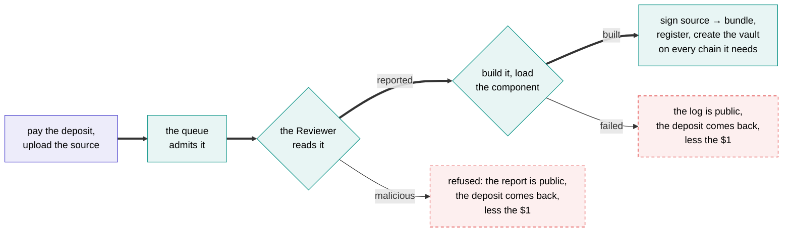

# Publishing

From a Cargo project to an open vault, with a public log at every step. [Authors](../authors.md) tells the same story in plain words; this page has the detail.



## What you submit

The whole **workspace** your agent belongs to, as it is: upload the folder or an archive of it. There is no packing step and no tool to install. The web app does it, and so does a single signed request to the [API](../reference/api.md#post-apisubmissions).

**Your wallet signs the submission**, naming the deposit that pays for it. That signature is the only link between an upload and a deposit, so nobody but you can spend your deposit on a build.

**You never compute a hash, and nobody trusts one from outside.** The attested Reviewer and the attested builder each take the files they received and hash them themselves.

You can upload it **sealed**. The browser encrypts the project to the platform's key, which is published on-chain, before it leaves your machine; the attested builder and the attested Reviewer still read it. The one thing outside an attested machine that sees it is the AI model the Reviewer consults, a hosted service whose terms rule out training on it or keeping it. Sealing changes who can read the source, never whether it was compiled or reviewed.

## Paying first

Nothing is compiled for free, so a job is only admitted once its **deposit** is paid: one transaction from the Author's wallet, on the chain of the agent's main venue, which is where its vault will live.

**Publishing costs a flat $1**, which covers the review and the build. The source size and build time limits below keep what either can cost us bounded, so one flat price holds. The rest of the deposit is whatever the Author wants in the tank to start with, and nothing past the $1 is required. A week at the declared allowances is a sensible start, since an agent whose tank runs dry stops.

The same transaction sets the vault's starting **allowances**, how much computing and gas the agent may use, and its **idle floor**, how much stays at home as cash. Both can be changed on the live vault later ([Configuration](configuration.md#vault-configuration)).

The deposit is held by a publishing contract, not by us. If a job is never finished, the Author can take the whole deposit back after a waiting period.

## The queue

Public, first come first served, one job in flight per Author, and the full log either way. A failed build's log is as public as a successful one's.

Each job shows its position while it waits, what it is doing while it builds, and how long it took when it is done.

## The review comes first

Before anything is compiled, the attested Reviewer reads the source. Compiling Rust runs the Author's own code, in build scripts and procedural macros, so reading it first means none of that runs on the builder until it has been read.

If the Reviewer finds the code **malicious**, the project is refused and never built. The $1 is spent, because the review ran; the rest of the deposit goes back to the Author; and the refusal is recorded on-chain against the source hash, with the full report public. No vault is ever created for it. Anything short of malicious is advice, and goes on to the build. [AI Review](../basics/ai-review.md) has what it looks for.

## What the review pins

The Reviewer runs on an attested machine, and its image pins:

- the model,
- the prompt and the output schema,
- the questions and their thresholds,
- the six areas, the four ratings and the three severities.

Changing any of them is an image change, which goes through the same public, timelocked allowlist as an executor image. The prompt, the schema and the questions are published, so an Author can run the same review themselves against any model they like before publishing. It just is not signed, and it is not binding.

## What the review records

Each agent is reviewed **once**, before it is built, and that review stays with it for the life of its vault. A later Reviewer image does not re-review agents that are already running.

A **refusal** is recorded in the transaction that returns the deposit: the source hash, the Reviewer's image and the hash of its report, which is public. There is no bundle, because nothing was built.

A review that goes on to the build is submitted to the review registry with the Reviewer's blessed key once the bundle is registered. The registry checks that the sender is blessed as a Reviewer on an allowed image, and that the bundle and source hashes match the agent registered:

```solidity
submitReview(strategyId, Review(
    bytes32  bundleHash,       // the bundle reviewed
    bytes32  sourceHash,       // the source the reviewer read
    bytes32  reviewerImage,    // the image it ran in
    bytes32  modelIdHash,      // the pinned model
    bytes32  promptHash,       // the prompt, the schema and the questions together
    bytes32  reportHash,       // the report as published
    uint8[6] ratings,          // one per area: fine, some concerns, serious, couldn't tell
    uint16   findingCount,
    uint64   reviewedAt
))
```

A review is of one source and the one bundle built from it, so a good rating can never follow code nobody read.

## The build

The recipe is fixed and published, so anyone can repeat it:

- a pinned toolchain and the build service's own copy of the SDK;
- `--locked`, so the dependency graph is the one the Author committed;
- the target is `wasm32-wasip2`, and `rustc` emits the component itself.

The project is built **once**. What a Depositor relies on is that an attested machine ran this recipe over that source and signed what came out of it, and an attested machine cannot misreport what it did.

The component is then loaded in the executor's own runtime, to check it satisfies the world before anything is registered, and the bundle, the component plus any models the project ships, is assembled and hashed.

!!! note "Why not build it twice and compare?"
    Because it would prove less than it looks. Two builds on the same machine, seconds apart, differ in almost nothing, so they test the easy cases and not the ones that actually break someone else's rebuild.

    Reproducing a bundle elsewhere is a property of a hermetic recipe, and making the recipe hermetic is the work: a pinned image, fixed paths, a fixed timestamp, no network.

    A project that reaches for a clock, the network or a random number while it compiles is a finding under reproducibility.

## The signature

The build service signs a digest that binds:

```text
(sourceHash, manifestHash) → bundleHash
```

together with the chain, the registry's own address, the agent's id (assigned when its deposit was paid), and its Author, so a signature for one registration can never be replayed as another. The strategy registry accepts a bundle **only** with that signature, from a key blessed for an allowlisted builder image.

The same attested key then **creates the vault**, in the same step as registering the bundle. The attested machines have read the manifest themselves, so they know which venues the agent trades and so which chains it needs: the vault lives on the chain of its main venue, with its shares and its tank, and it gets its own accounts on every other chain it trades. The deposit, less the $1, becomes its tank.

Every one of those steps is a transaction the attested machine sends, and transactions cost gas: registering the bundle, creating the vault, and setting up its accounts on each other chain. That gas comes out of the deposit, like any gas the agent's own transactions cost later, so an agent that trades on several chains starts with a slightly smaller tank.

A vault's executors are then blessed for that exact `bundleHash`, so the chain from published source to running code is unbroken.

## Admission and charges

- A job is admitted once its deposit is paid and the submission carries its Author's signature.
- **Every submission has limits, generous but not unlimited:** a maximum size for the source, and a maximum time to build it. They're published with the other parameters. A project over the size limit is refused before the review runs, so it costs nothing; a build that runs past the time limit fails like any failed build.
- **A refused project or a failed build spends the $1, because it ran.** The rest of the deposit goes back, less the gas to send it, and no vault is created. To try again, you submit a new agent.
- A build service that crashes requeues the job at no charge.

## Opening

The vault opens as soon as it's created. From that moment it takes deposits, labelled **new** until it has some history.

## What you get

An agent page with:

- the record, read from the vault's own contract;
- the review, with its ratings and findings;
- the source, the `Cargo.toml` and the `Cargo.lock`, the build log and the toolchain;
- the bundle, component, source and manifest hashes;
- which keys are blessed for the vault and what they may run;
- the vault: its value, its fees, its tank, its claims.

[Next: under the hood →](../under-the-hood/machines.md){ .md-button .md-button--primary }
