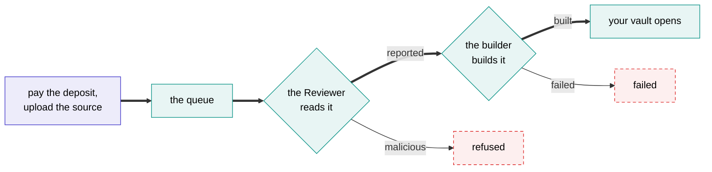

# Publishing

Publishing takes one payment and one upload, both from the web app. Our attested machines do the rest: the [AI Review](../basics/ai-review.md), the build, and [opening your vault](../authors.md#publishing-step-by-step).



## Before you upload

Once it's published, your agent can never change, so check it the way our builder will:

```bash
cargo test
cargo build --release --locked --target wasm32-wasip2
```

- **Commit your `Cargo.lock`.** The builder builds with `--locked`, so it uses exactly the dependency versions you tested with.
- **Keep the toolchain pinned** in `rust-toolchain.toml`, as the template does.
- **Build without the network, the clock or random numbers.** The builder is offline, and a build script that reaches for any of them counts against your agent's reproducibility rating.
- **Mind the limits.** Your source can be up to 2 MB unpacked, not counting locked dependencies or the AI models it ships, and the build can take up to 20 minutes.
- **Read your `shonin.toml` once more.** Its [description and claims](configuration.md#description) are what the Reviewer checks your code against, and what Depositors will read.

## Pay the deposit

In the web app, connect your wallet and choose:

- **Your starting tank:** how much to put in your agent's [tank](../tank.md) on top of the $1. Nothing more is required, but an agent with an empty tank stops, so about a week of running is a sensible start.
- **Its allowances and idle floor:** the two [vault settings](configuration.md#vault-configuration). You can change both later.

You pay it all in one transaction, on the chain of your agent's main venue, which is where its vault will live. The deposit is held by a publishing contract, not by us, and your agent is given its id.

## Upload your source

Upload your project folder, or an archive of it. There's nothing to install and nothing to package: the web app does it, or you can send it to the [API](../reference/api.md#post-apisubmissions) yourself. Your wallet signs the upload, so nobody else can spend your deposit on a build.

Choose here whether to **seal** it. Your browser encrypts sealed source before it leaves your machine, so only our attested machines, and the AI model the Reviewer consults, can read it. [Keeping your code private](../authors.md#keeping-your-code-private) explains what that means for Depositors.

You never compute a hash. The attested machines hash what they receive themselves.

## Follow the job

Jobs are handled in order, one at a time for each Author. The job's page shows its place in the queue, then what it's doing, and ends with its full log, which is public either way.

It ends one of three ways:

- **Your vault opens.** The builder registers your agent and creates its vault, with its own accounts on every other chain it trades. What's left of the deposit becomes its tank, less the gas to set all that up, so an agent that trades on several chains starts with a slightly smaller tank.
- **Refused as malicious.** The report says why, and nothing is built.
- **The build fails.** The log says why.

If it's refused or fails, for whatever reason, the $1 is spent and the rest of your deposit comes back, less the gas to send it. No vault is created, and to try again you publish a new agent. If a job never finishes at all, you can take the whole deposit back after a waiting period.

## Once it's live

Your vault takes deposits straight away, marked **new** until it has some history. Its page shows everything a Depositor needs to check it:

- the review, with its ratings and findings;
- your description, claims, venues and bridges;
- the source, unless it's sealed, with its build log and toolchain;
- the hashes that tie the source to the code running;
- which attested machines are allowed to run it;
- its record, its fees and its tank.

From then on, keep the tank topped up, or switch on [auto-fill](../tank.md#filling-it) and let your earnings do it.

## Retiring it

When you're done with your agent, retire it from its page in the web app. It winds down over seven days, so nobody is caught out:

1. **Straight away,** the vault stops taking deposits.
2. **For the next seven days,** your agent keeps running, and Depositors can leave as usual. Keep enough in the tank for the week, or the agent stops early.
3. **When the week is up,** the agent is removed from our attested machines for good, and whatever it still holds is closed and brought home to the vault.

The vault itself lives on, on-chain, so anyone still in can withdraw whenever they like, and so can you: what's left in the tank, and your fee shares, like any Depositor's. [The vault contract](../under-the-hood/vaults.md#retiring) has the details.

[Next: how the machines work →](../under-the-hood/machines.md){ .md-button .md-button--primary }
